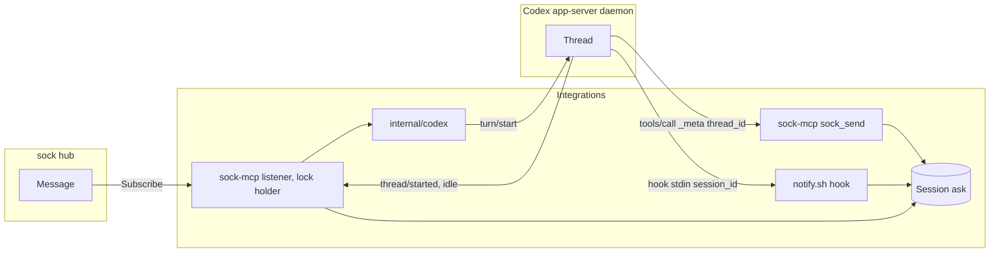
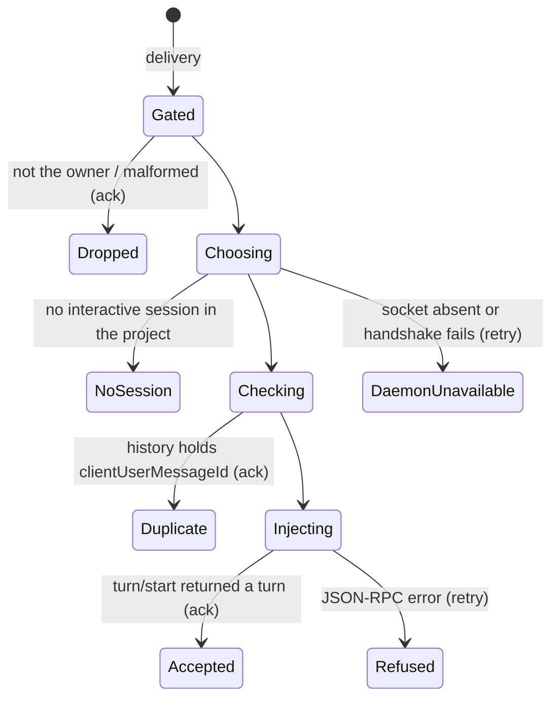
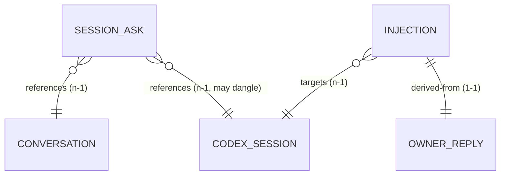
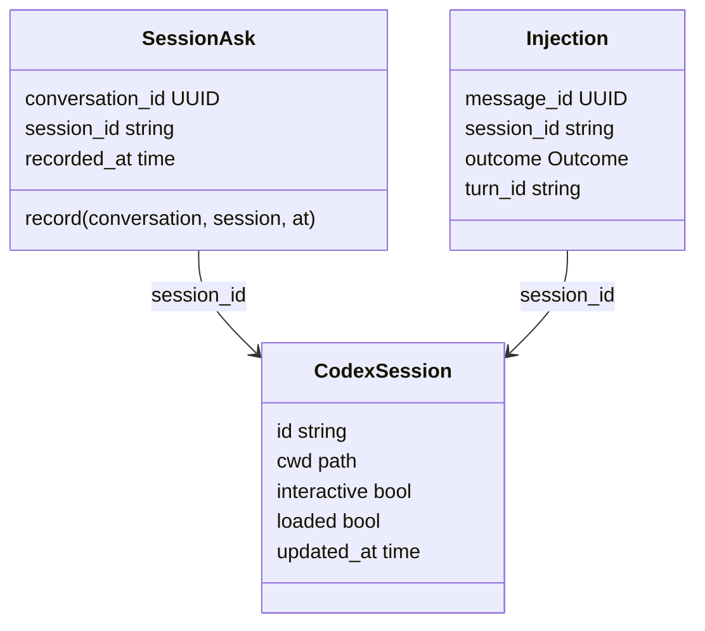

# Codex inbound: the owner's reply reaches the Codex session

Pass 4 (2026-10-15): the plugin's own server listens ([ADR 2](../adr/0002-the-plugin-server-listens-for-codex.md), superseding the service of [ADR 1](../adr/0001-codex-replies-enter-through-the-app-server.md)). Bead integrations-2ol.

A Codex session asks the owner something through sock. The owner answers in sock. The answer arrives in that Codex session as a turn, whether a person has the session open or not.

## Context map

Subdomain: supporting (delivery into one agent platform). Shallow model, no hub change.

| Context | Owns | Relationship |
|---|---|---|
| Integrations (this repo and the Codex plugin's sock-mcp) | Owner reply, session ask, injection, listener | Conformist downstream of the hub's Subscribe stream (through sock-mcp's `channel` package) and sock-client puppets |
| Codex app-server (OpenAI) | Thread, turn, loaded set | Upstream. An anti-corruption layer (sock-mcp `internal/codex`) translates its protocol; no Codex term leaves it except a session id |
| sock hub | Message, conversation, puppet, owner | Upstream through sock-cli and sock-mcp, unchanged |

### Language

| Term | Meaning |
|---|---|
| Owner reply | A delivery on a project puppet's Subscribe stream whose sender is that puppet's owner. Anything else is acknowledged and dropped by the `channel` package's allowlist. |
| Codex session | One Codex conversation thread, as the app-server names it (`threadId`). Interactive: `threadSource` is `user` and it is not `ephemeral`. Codex also loads ephemeral threads (title generation) in the same directory; those are never a Codex session here. |
| Session ask | The fact that a Codex session last posted to a conversation: which session, which conversation, when. |
| Injection | Handing an owner reply to a Codex session as user input through the app-server (`turn/start`). The session must be loaded in the daemon; it need not be open in a TUI, since the daemon runs the turn either way. A session that is not loaded is never resumed: resuming would run it under the settings the daemon derives then, not the ones it was started with. |
| Project | A loaded session's `cwd` as the puppet names it (sock-client `Project`: the repository's git common dir, so every worktree is the same project and a nested repository is another, or the directory itself outside git). A Codex session belongs to it when its `cwd` has the same project. The listener serves a project only when its puppet is already cached: only a puppet that exists can have messaged the owner. |

| Listener | The one plugin `sock-mcp` on the machine holding `sock-integrations/codex-inbound.lock`. It subscribes per served project and rescans when the daemon starts a thread or one goes idle. |

Ambiguous: "session". sock-runner's `SOCK_RUNNER_SESSION` and Claude Code's session id are other platforms' sessions; here it always means a Codex thread. "Turn" is Codex's word and stays inside the injector.

Stored: the session ask. Derived: which session gets a reply (computed at delivery from the ask and the daemon's current state, never stored).

## Domain model

### Session ask (entity, identity: conversation id)

| Field | Type | Meaning |
|---|---|---|
| conversation_id | UUID | The sock conversation the session posted to. Identity: one ask per conversation. |
| session_id | string, `[A-Za-z0-9_-]{1,64}` | The Codex thread id that posted last. |
| recorded_at | time, UTC | When the post went out. Newer replaces older. |

Behaviors: `record(conversation, session, at)` replaces the ask only when `at` is not older than the stored one, so two writers racing leave the newest. Invariant: session_id matches its pattern (it becomes a JSON-RPC argument; nothing else is accepted). No lifecycle beyond replacement; a session that no longer exists is discovered at injection, not by expiring the ask.

Writers: sock-mcp `sock_send` (session from `_meta["x-codex-turn-metadata"].thread_id`, conversation from the posted message), and `notify.sh` after a successful `sock send` from a Codex hook (session from stdin `session_id`, conversation from `sock send --json`). Reader: the listener.

Relationships: references one conversation (n-1, by id); references one Codex session (n-1, by id, may dangle).

### Codex session (value object, a snapshot read through the ACL)

| Field | Type | Meaning |
|---|---|---|
| id | string | `threadId`. |
| cwd | absolute path | The session's working directory. |
| interactive | bool | `threadSource == "user"` and not `ephemeral`. |
| loaded | bool | In `thread/loaded/list` now. Only a loaded session is a candidate. |
| updated_at | time | Codex's `updatedAt`; orders candidates. |

Never stored; read per delivery.

### Injection (value object, the outcome of one delivery)

| Field | Type | Meaning |
|---|---|---|
| message_id | UUID | The owner reply's sock message id; also `clientUserMessageId` on `turn/start`, so the session's history names it. |
| session_id | string | The session chosen. |
| outcome | enumeration | `accepted`, `duplicate`, `no session`, `refused`, `daemon unavailable`. |
| turn_id | string | Codex's turn id, for `accepted` only. Every other outcome carries its evidence in the log line instead. |

`turn_id` exists only on `accepted`; the log line per outcome is the record, so no row carries a conditional field.

Anything unlisted does not happen. `no session` leaves the reply pending (decision 1).

### Choosing the session (rule on the injection, no aggregate of its own)

1. The session ask for the reply's conversation, when that session is interactive, loaded and in the project.
2. Otherwise the loaded interactive session in the project with the newest `updated_at`.
3. Otherwise `no session`.

## Contracts

### API

No hub endpoint is added or changed. The contracts here are local process interfaces.

Caller classes:
- The hub, over a project puppet's Subscribe stream. Trusted for the delivery's sender id; not trusted for the text.
- The Codex app-server, as the local user's own daemon over a mode-0700 Unix socket. Trusted for `_meta`, hook stdin and its thread list (the model cannot set any of them); not trusted for anything a model wrote.

| Interface | Caller | Authn | Authz | Request | Response | Errors | Idempotency | Behavior |
|---|---|---|---|---|---|---|---|---|
| `sock-mcp --outbound-only --codex-inbound` (the plugin's server, `mcp.json`) | Codex daemon | Same user; credential from the config file's machine key | Owner allowlist (`channel`) | a delivery: conversation id, message id, sender, text | ack once injected or found already there | `no-session` (stays pending), `refused` and `daemon-unavailable` (retried 5 times with backoff, then pending until the stream reconnects) | `clientUserMessageId` = message id, checked across every candidate session | `codex.Daemon.Inject`: `thread/loaded/list`, `thread/read` of each loaded thread (`thread/list` leaves out a thread with no turn yet; source `cli` or `vscode` only), `thread/items/list`, `turn/start` |
| `codex.Daemon.Watch` | the listener | Unix socket permissions | none | none | a rescan on connect, `thread/started` and a thread going idle | connection ended: reconnect with backoff to 30 s | none | `codex.Daemon.Projects` |
| Session ask write | sock-mcp, notify.sh | Same user; file mode 0600 | none | conversation id, session id, time | none | a failed write is logged and never fails the send | replace-if-newer | `asks.Record` |

The prompt is `codex.Prompt`, the shape of `runner/lib.sh`'s: the one-line preface and `<sock-message from="owner" conversation=… id=…>` with closing tags broken. The owner's text reaches Codex as user input inside that tag, never bare.

### Domain events

None of ours. The listener consumes the hub's Subscribe stream and the daemon's `thread/started` and `thread/status/changed` notifications; it acknowledges on `turn/start` acceptance, not on turn completion.

### Data

Local state on the owner's machine under `${XDG_STATE_HOME:-~/.local/state}/sock-integrations`.

| Store | Owner | Shape | Key | Constraints |
|---|---|---|---|---|
| `codex-asks/<conversation id>` | Session ask | One line: `<session id> <recorded_at unix seconds>` | conversation id (file name, UUID-checked) | mode 0600; written to a temp file and renamed; session id pattern checked on write and read |
| `codex-inbound.lock` | Listener | empty; held with `flock` | none | one holder per machine; the kernel frees a dead holder's lock |

Recorded exception to the local-state rule (SQLite for end-user state): one writer is a shell hook, and each record is one key with one value replaced whole. A table would be one row per conversation with the same three columns.

### Cross-check

| Transition | Interface | Event | Store |
|---|---|---|---|
| Session ask recorded | sock-mcp send, notify.sh send | none (local) | `codex-asks` |
| Owner reply injected | listener push | none: the ack is the record upstream | the session's history (`clientId`) |
| Duplicate | listener push, acked | none | the session's history |
| No session | listener push, not acked | none | none: the reply stays pending at the hub |

## Decisions

1. No loaded Codex session in the project: the reply stays pending at the hub. Nothing starts a session on the owner's behalf. No Codex session anywhere means no listener, which is the same outcome.
2. A turn that needs a tool approval while nobody has the session open waits until someone opens it. The `PermissionRequest` hook tells the owner; approving from sock is out of scope.

## Running it

Install the plugin. The plugin's server runs with `--codex-inbound`; it needs a machine key in `~/.config/sock/config.toml` (`sock machine-key use`). A server holding only a `puppet_token` says so on stderr and only sends.

## Open questions

1. The app-server protocol is marked experimental and the daemon updates itself (0.163.0 while the CLI is 0.162.1). The injector pins nothing; a protocol change shows as `refused` and the reply stays pending.
2. Sessions in the ChatGPT desktop app run under the app's own app-server, reachable only over its stdio, and receive nothing. Its plugin servers can still hold the lock and inject into daemon sessions.
