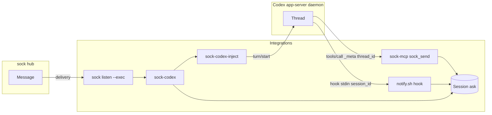
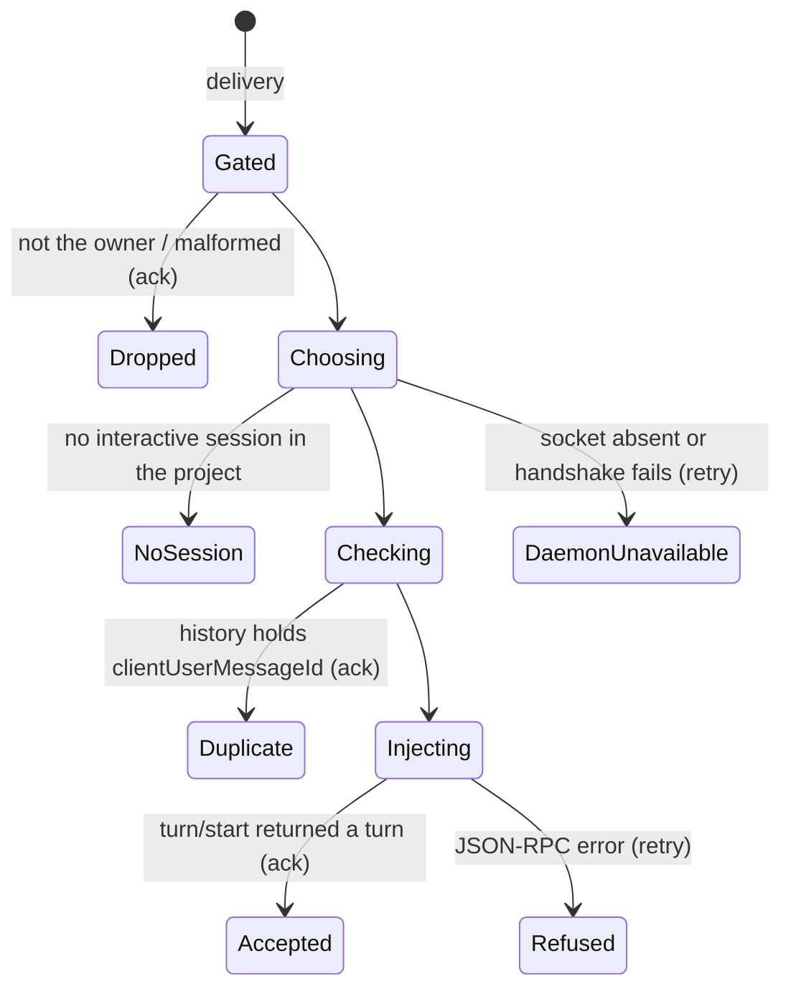
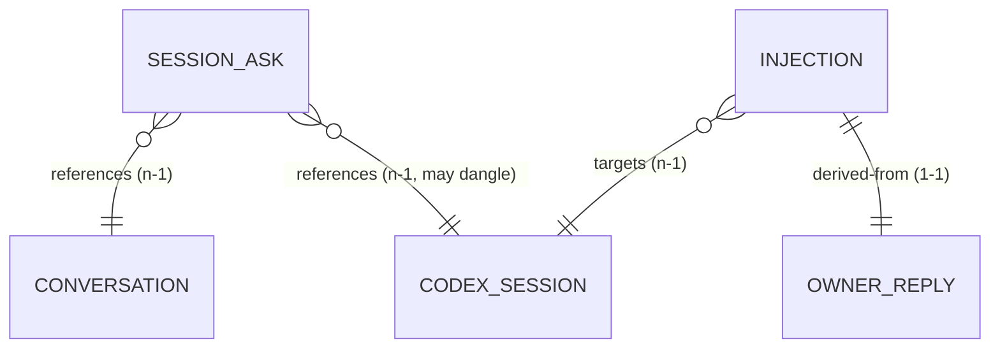
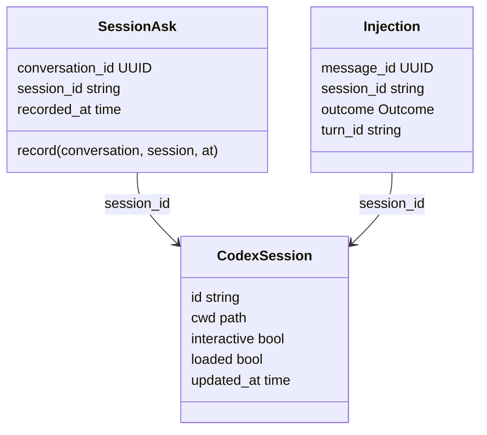

# Codex inbound: the owner's reply reaches the Codex session

Pass 3 (2026-10-15): owner decisions recorded; security review fixes (project identity, loaded sessions only). Bead integrations-2ol. Decision record: [ADR 1](../adr/0001-codex-replies-enter-through-the-app-server.md).

A Codex session asks the owner something through sock. The owner answers in sock. The answer arrives in that Codex session as a turn, whether a person has the session open or not.

## Context map

Subdomain: supporting (delivery into one agent platform). Shallow model, no hub change.

| Context | Owns | Relationship |
|---|---|---|
| Integrations (this repo) | Owner reply, session ask, injection | Conformist downstream of `sock listen --exec` (sock-cli) and the sock-mcp tool contract |
| Codex app-server (OpenAI) | Thread, turn, loaded set | Upstream. An anti-corruption layer (`sock-codex-inject`) translates its protocol; no Codex term leaves it except a session id |
| sock hub | Message, conversation, puppet, owner | Upstream through sock-cli and sock-mcp, unchanged |

### Language

| Term | Meaning |
|---|---|
| Owner reply | A delivery from `sock listen` whose sender is the receiving puppet's owner. Anything else is not one and is dropped by the existing gate (`runner/lib.sh`). |
| Codex session | One Codex conversation thread, as the app-server names it (`threadId`). Interactive: `threadSource` is `user` and it is not `ephemeral`. Codex also loads ephemeral threads (title generation) in the same directory; those are never a Codex session here. |
| Session ask | The fact that a Codex session last posted to a conversation: which session, which conversation, when. |
| Injection | Handing an owner reply to a Codex session as user input through the app-server (`turn/start`). The session must be loaded in the daemon; it need not be open in a TUI, since the daemon runs the turn either way. A session that is not loaded is never resumed: resuming would run it under the settings the daemon derives then, not the ones it was started with. |
| Project | The project the runner service serves (`--project <dir>`), as the puppet names it (sock-client `Project`: the repository's git common dir, so every worktree is the same project and a nested repository is another, or the directory itself outside git). A Codex session belongs to it when its `cwd` has the same project. |

Ambiguous: "session". sock-runner's `SOCK_RUNNER_SESSION` and Claude Code's session id are other platforms' sessions; here it always means a Codex thread. "Turn" is Codex's word and stays inside the injector.

Stored: the session ask. Derived: which session gets a reply (computed at delivery from the ask and the daemon's current state, never stored).

## Domain model

### Session ask (entity, identity: conversation id)

| Field | Type | Meaning |
|---|---|---|
| conversation_id | UUID | The sock conversation the session posted to. Identity: one ask per conversation. |
| session_id | string, `[A-Za-z0-9_-]{1,64}` | The Codex thread id that posted last. |
| recorded_at | time, UTC | When the post went out. Newer replaces older. |

Behaviors: `record(conversation, session, at)` replaces the ask only when `at` is not older than the stored one, so two writers racing leave the newest. Invariant: session_id matches its pattern (it becomes a JSON-RPC argument; nothing else is accepted). No lifecycle beyond replacement; a session that no longer exists is discovered at injection, not by expiring the ask.

Writers: sock-mcp `sock_send` (session from `_meta["x-codex-turn-metadata"].thread_id`, conversation from the posted message), and `notify.sh` after a successful `sock send` from a Codex hook (session from stdin `session_id`, conversation from `sock send --json`). Reader: `sock-codex`.

Relationships: references one conversation (n-1, by id); references one Codex session (n-1, by id, may dangle).

### Codex session (value object, a snapshot read through the ACL)

| Field | Type | Meaning |
|---|---|---|
| id | string | `threadId`. |
| cwd | absolute path | The session's working directory. |
| interactive | bool | `threadSource == "user"` and not `ephemeral`. |
| loaded | bool | In `thread/loaded/list` now. Only a loaded session is a candidate. |
| updated_at | time | Codex's `updatedAt`; orders candidates. |

Never stored; read per delivery.

### Injection (value object, the outcome of one delivery)

| Field | Type | Meaning |
|---|---|---|
| message_id | UUID | The owner reply's sock message id; also `clientUserMessageId` on `turn/start`, so the session's history names it. |
| session_id | string | The session chosen. |
| outcome | enumeration | `accepted`, `duplicate`, `no session`, `refused`, `daemon unavailable`. |
| turn_id | string | Codex's turn id, for `accepted` only. Every other outcome carries its evidence in the log line instead. |

`turn_id` exists only on `accepted`; the log line per outcome is the record, so no row carries a conditional field.

Anything unlisted does not happen. `no session` leaves the reply pending (decision 1).

### Choosing the session (rule on the injection, no aggregate of its own)

1. The session ask for the reply's conversation, when that session is interactive, loaded and in the project.
2. Otherwise the loaded interactive session in the project with the newest `updated_at`.
3. Otherwise `no session`.

## Contracts

### API

No hub endpoint is added or changed. The contracts here are local process interfaces.

Caller classes:
- `sock listen --exec`, as the project's puppet (runner service). Trusted to assert the delivery it received; not trusted for the text, which is the sender's.
- The Codex app-server, as the local user's own daemon over a mode-0700 Unix socket. Trusted for `_meta` and hook stdin (the model cannot set either); not trusted for anything a model wrote.

| Interface | Caller | Authn | Authz | Request | Response | Errors | Idempotency | Behavior |
|---|---|---|---|---|---|---|---|---|
| `sock-codex` (a `sock listen --exec` command) | sock listen | Same user; `SOCK_TOKEN` resolved by `--as-puppet` | Owner gate (`lib.sh`) | protojson `sock.v1.Message` on stdin; `SOCK_MESSAGE_ID`, `SOCK_CONVERSATION_ID`, `SOCK_SENDER_ID` | exit 0 ack, 1 retry, 2 config | `lib.sh` taxonomy plus `no session`, `refused`, `daemon unavailable` | `done.ids` ledger, then the session history's `clientUserMessageId` | Choose session, inject |
| `sock-codex-inject --project DIR --conversation UUID --message-id UUID` (Go, the ACL) | sock-codex | Same user; Unix socket permissions | none beyond the socket | prompt on stdin (already tagged by `lib.sh`), at most 1 MiB | stdout one line: outcome, then `session=<id>` and `turn=<id>` when known | exit 0 accepted, 3 duplicate, 4 no session, 5 refused, 6 daemon unavailable, 2 usage; `sock-codex` maps 0 and 3 to ack, 4 to 6 to retry, 2 to configuration | as above | `thread/loaded/list`, `thread/list` (`sourceKinds` `cli` and `vscode`), `thread/items/list` (the duplicate check, across every candidate), `turn/start` |
| Session ask write | sock-mcp, notify.sh | Same user; file mode 0600 | none | conversation id, session id, time | none | a failed write is logged and never fails the send | replace-if-newer | `SessionAsk.record` |

The prompt is `lib.sh`'s: the one-line preface and `<sock-message from="owner" conversation=… id=…>` with closing tags broken. The owner's text reaches Codex as user input inside that tag, never bare.

### Domain events

None. Nothing crosses a context boundary as an event: the hub's message delivery is consumed through `sock listen`, and Codex's turn notifications are not subscribed to (the ack is on `turn/start` acceptance).

### Data

Local state on the owner's machine, beside the runner's ledgers in `SOCK_RUNNER_STATE`.

| Store | Owner | Shape | Key | Constraints |
|---|---|---|---|---|
| `codex-asks/<conversation id>` | Session ask | One line: `<session id> <recorded_at unix seconds>` | conversation id (file name, UUID-checked) | mode 0600; written to a temp file and renamed; session id pattern checked on write and read |
| `done.ids` | Injection (shared with sock-runner) | last 200 message ids | message id | as sock-runner |

Recorded exception to the local-state rule (SQLite for end-user state): the writers are a shell hook and sock-mcp, the runner's ledgers are already files, and each record is one key with one value replaced whole. A table would be one row per conversation with the same three columns.

Location shared by writers and reader: sock-mcp and `notify.sh` run in the Codex session; the runner service runs under launchd. All three resolve `${XDG_STATE_HOME:-$HOME/.local/state}/sock-integrations/codex-asks`, not `SOCK_RUNNER_STATE`, since the writers do not know the runner's per-project directory.

### Cross-check

| Transition | Interface | Event | Store |
|---|---|---|---|
| Session ask recorded | sock-mcp send, notify.sh send | none (local) | `codex-asks` |
| Owner reply injected | `sock-codex` exit 0 | none: the ack is the record upstream | `done.ids` |
| Duplicate | `sock-codex` exit 0 | none | `done.ids` or session history |
| No session | `sock-codex` exit 1 | none | none: the reply stays pending at the hub |

## Decisions

1. No interactive Codex session in the project: the reply stays pending (exit 1). `sock listen` retries it five times with backoff, then holds it until it reconnects. Nothing starts a session on the owner's behalf.
2. A turn that needs a tool approval while nobody has the session open waits until someone opens it. The `PermissionRequest` hook tells the owner; approving from sock is out of scope.

## Running it

`SOCK_RUNNER_AGENT=codex-live runner/sock-runner-service install <project>` keeps `sock listen --as-puppet --project <project> --exec runner/sock-codex` running, as for sock-runner. Needs `sock-codex-inject` on `PATH` (`make install-bins`).

## Open questions

1. The app-server protocol is marked experimental and the daemon updates itself (0.163.0 while the CLI is 0.162.1). The injector pins nothing; a protocol change shows as `refused` and the reply stays pending.
2. Several runner services and the Codex desktop app share one daemon. Only the project's own runner injects into that project's sessions; the desktop app is unaffected. Not yet checked with the app open.
