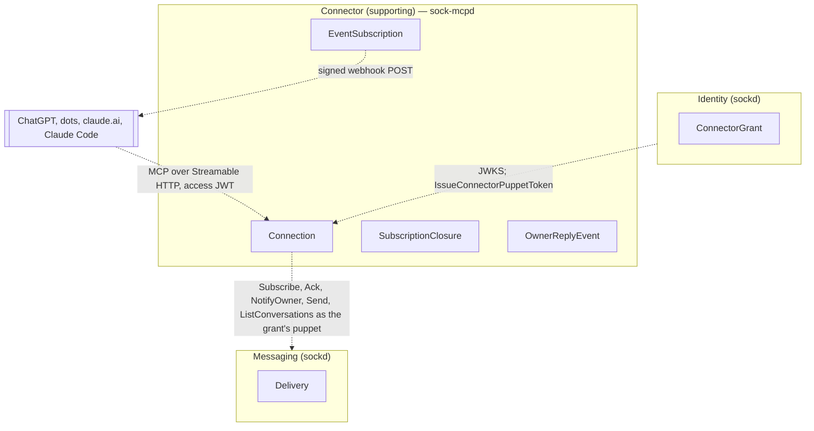
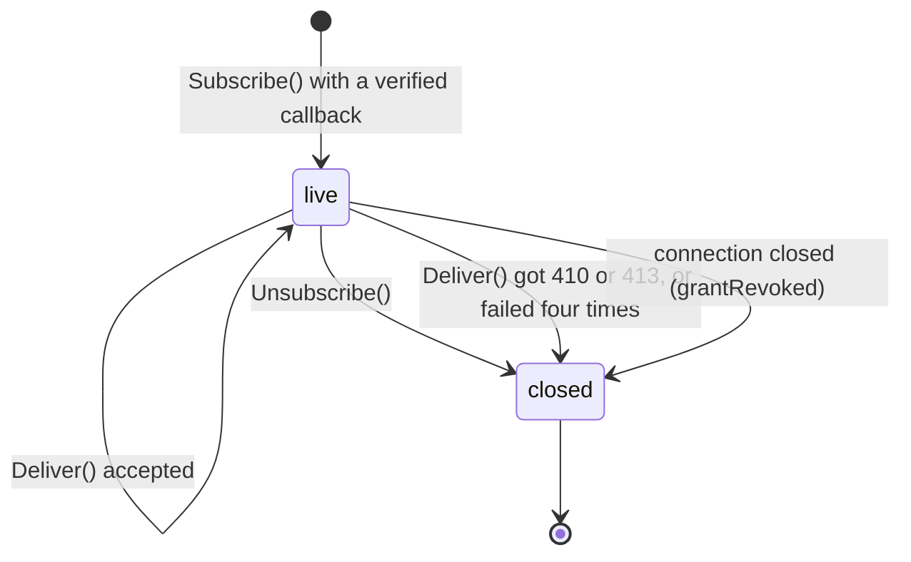
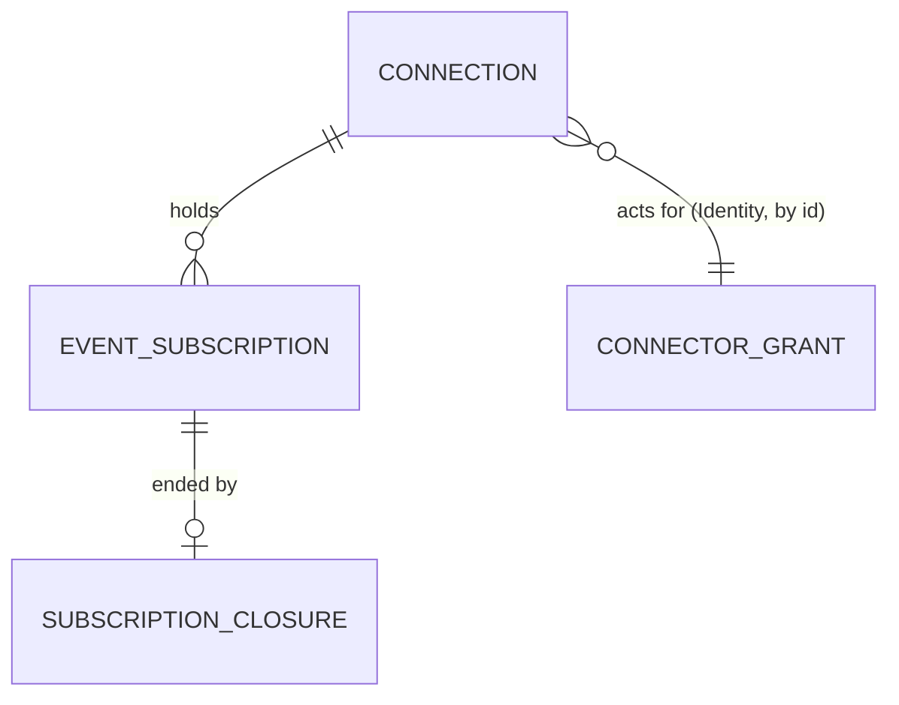

# sock-mcpd: the Connector service

Pass 1. Decisions: [ADR 11](https://github.com/aeryx-ai/sock-contract/blob/main/docs/adr/0011-agent-platforms-connect-through-oauth.md) in `sock-contract` (Identity's authorization server and the connector grant). Language: the `sock-contract` [context map](https://github.com/aeryx-ai/sock-contract/blob/main/docs/specs/context-map.md). The service is the Connector bounded context: an OAuth-connected agent platform talking to sock over MCP. Conformist downstream of Identity (OAuth, `IssueConnectorPuppetToken`) and Messaging (an ordinary puppet caller per grant). Supporting subdomain. It holds no human identity and no message history.

Out: the plugin directory listing package and client setup ([integrations](integrations.md), "Hosted connector"), the authorization server (`sockd`), hooks of any kind, claude.ai inbound.

## Contexts



Across the boundary: grant ids and puppet tokens from Identity, deliveries from Messaging, event payloads to a platform. Never a human account id, a handle or an Apple identifier.

## Connection

Entity, aggregate root. `sock-mcpd`'s view of one connector grant: the puppet it acts as and the credential for it. Created the first time a request arrives with an access token for a grant this service has not seen; one per grant.

### Fields

| Field | Type | Meaning |
|---|---|---|
| `grantId` | UUID | The access token's `sub`. Identity within the service |
| `puppetTokenCiphertext` | bytes | The grant's `sock_pt_` token, AES-256-GCM under `SOCK_MCPD_TOKEN_KEY`, nonce prefixed. Never logged, never returned |
| `puppetId` | UUID | From `sock whoami` with that token, for the sender gate |
| `ownerId` | UUID | `account.puppet.ownerId` from the same call: the only sender whose messages become events |
| `createdAt` | Timestamp | |

Closure is not a field. A connection whose puppet token the hub refuses (`TOKEN_INVALID`: the grant was revoked) is deleted together with its subscriptions, each closed with cause `grantRevoked`.

### Behaviors

- `Open(accessToken)` (factory): verifies the JWT, calls `IssueConnectorPuppetToken` with the service token and the JWT, calls `whoami` with the result, stores the ciphertext, puppet id and owner id. On `ALREADY_ISSUED` (a previous instance of this service held it and lost the database) it calls `RevokeConnectorDevice` with the same JWT and issues again, logging the recovery for the operator
- `Call(tool, input)`: `sock_whoami`, `sock_list_conversations`, `sock_send` with the puppet token, through the `sock-mcp` tool implementations
- `Stream()`: one `Subscribe` on the puppet token, reconnecting with the CLI's backoff, held open while the connection has at least one live `EventSubscription`; otherwise not opened (nothing to deliver to), so deliveries wait in the hub's queue
- `Deliver(delivery)`: the sender gate, then one `OwnerReplyEvent` per live subscription; `Ack` after every subscription accepted it (2xx) or was closed trying
- `Close(cause)`: closes every subscription with the cause and deletes the connection

### Invariants

- One connection per grant; the puppet token is held once and only as ciphertext.
- A delivery whose `senderId` is not `ownerId` never becomes an event; it is acked and dropped (the runner's rule).
- A delivery is acked only after every live subscription accepted it; a subscription that fails terminally (410, 413, four failed attempts) is closed first, so a dead webhook never holds the queue.
- No message body is stored; the delivery lives in memory between the stream and the webhook.

### Relationships

| With | Kind | Cardinality |
|---|---|---|
| `EventSubscription` | has-a | 1 to n, n ≥ 0 |
| `ConnectorGrant` (Identity) | references, by `grantId` | 1 to 1 |

## EventSubscription

Entity, owned by `Connection`. A platform's webhook registration for one event on this connection, made by `events/subscribe`.

### Fields

| Field | Type | Meaning |
|---|---|---|
| `id` | UUID | Returned to the platform; `X-MCP-Subscription-Id` on every delivery |
| `grantId` | UUID | |
| `event` | `EventName` | `owner.reply`, the only event in v1 |
| `webhookUrl` | string | `https` only, public address only (checked at subscribe time and again before each delivery), at most 2048 characters |
| `secretCiphertext` | bytes | The platform's `whsec_` secret (24 to 64 bytes decoded), encrypted like the puppet token; signs every delivery |
| `cursor` | int64 | The number of events this subscription delivered and the platform accepted, 0 at creation; returned on subscribe and re-subscribe. It is a progress count, not a replay position: the hub queue is the replay mechanism (an undelivered message comes back on the next stream), and a cursor sent on subscribe is accepted and ignored |
| `createdAt` | Timestamp | |

Closure is not a field. A closed subscription has a `SubscriptionClosure` row.

### Behaviors

- `Subscribe(event, webhookUrl, secret, cursor)` (factory): validates the URL and secret, runs the callback verification (`{"type":"verification","challenge"}` signed; the webhook must echo the challenge or the subscribe fails with JSON-RPC `-32015`), returns `id`, `cursor`, `refreshBefore` (null: no expiry) and `truncated` false
- `Deliver(event)`: one POST, body `{eventId, name, timestamp, data, cursor}`, at most 256 KiB, headers `webhook-id`, `webhook-timestamp`, `webhook-signature` (Standard Webhooks HMAC-SHA256 over `id.timestamp.body`), `X-MCP-Subscription-Id`; `2xx` acknowledges; `410` and `413` close the subscription; anything else retries with backoff 1, 2, 4 s and the same `eventId`, then closes with `deliveryFailed`
- `Unsubscribe()`: closes with `unsubscribed`

### Invariants

- The secret decrypts only to sign a delivery and is never returned, logged or echoed.
- Deliveries to one subscription follow the hub stream order; `cursor` increases by one per accepted event and never decreases. `seq` is per conversation and travels in `data`, never as the cursor.
- A subscription whose connection closed is closed with `grantRevoked` before the connection row goes.

### States



Anything not drawn is refused.

### Relationships

| With | Kind | Cardinality |
|---|---|---|
| `Connection` | owned by | n to 1 |
| `SubscriptionClosure` | has-a | 1 to 0..1 |

## SubscriptionClosure

Value object, owned by `EventSubscription`, 0 or 1. Why a subscription ended.

| Field | Type | Meaning |
|---|---|---|
| `subscriptionId` | UUID | |
| `cause` | `ClosureCause` | `unsubscribed`, `gone` (410), `tooLarge` (413), `deliveryFailed`, `grantRevoked` |
| `closedAt` | Timestamp | |

When a subscription closes for `gone`, `tooLarge` or `deliveryFailed`, the connection posts one `NotifyOwner` as its puppet: "<platform> stopped receiving your replies"; the owner reconnects from the platform. Closed rows are kept 30 days for the operator, then swept.

## OwnerReplyEvent

Value object, never stored. One owner delivery as a platform sees it.

| Field | Type | Meaning |
|---|---|---|
| `eventId` | string | The delivery's message id; the same id on every retry and on every subscription, so platforms dedupe |
| `name` | string | `owner.reply` |
| `timestamp` | RFC 3339 | The message's `sentAt` |
| `data.conversationId` | UUID | |
| `data.messageId` | UUID | |
| `data.seq` | int64 | |
| `data.text` | string | The owner's Markdown, as sent, up to 65536 bytes |
| `cursor` | int64 | The subscription's accepted-delivery count after this event |

The event schema (`payloadSchema` in `events/list`) is this object; `inputSchema` for `events/subscribe` is empty: a subscription covers every reply to the connection's puppet.

## Enumerations

`EventName`: `owner.reply`.

`ClosureCause`: `unsubscribed`, `gone`, `tooLarge`, `deliveryFailed`, `grantRevoked`.

## Everything at once



## Transport and auth in

- `POST https://mcp.sock.aeryx.ai/mcp`, MCP over Streamable HTTP, protocol revision `2026-07-28` (events need it; the Go MCP SDK's support for the revision's discovery handshake is the first thing the implementation plan checks) with the legacy `initialize` accepted for clients that still send it.
- `GET /.well-known/oauth-protected-resource/mcp` and `GET /.well-known/oauth-protected-resource` (RFC 9728): `resource` = `https://mcp.sock.aeryx.ai/mcp`, `authorization_servers` = [`https://api.sock.aeryx.ai`], `scopes_supported` = [`sock`], `bearer_methods_supported` = [`header`].
- `GET /.well-known/openai-apps-challenge`: the exact token OpenAI's portal gives, as `text/plain`.
- `GET /healthz`: 200 when the database answers, 503 otherwise, no data.
- Every `/mcp` request carries `Authorization: Bearer <access JWT>`. Verified offline against the hub's JWKS (cached by `Cache-Control`, refreshed on an unknown `kid` at most once a minute): ES256, `iss` = the hub, `aud` = this resource exactly, `exp`, `scope` contains `sock`. Missing or invalid: `401` with `WWW-Authenticate: Bearer resource_metadata="https://mcp.sock.aeryx.ai/.well-known/oauth-protected-resource/mcp"`; a valid token without the scope: `403` with `error="insufficient_scope"`. Nothing else is accepted: no API keys, no puppet tokens, no cookies.
- The `sub` names the connection. The first request for an unknown `sub` opens it (`Connection.Open`), which is the only call that costs a hub round trip for identity; later requests use the stored ciphertext.

## Tools

The three sending tools, linked from `sock-mcp` as a library in outbound-only form: `sock_whoami`, `sock_list_conversations`, `sock_send`. Same names, schemas and descriptions as the stdio server, pinned by the drift test in `test/`. Every tool declares `securitySchemes: [{type: oauth2}]` for the OpenAI package. No `sock_fetch`, no `sock_ack`: this service is the single consumer of every connector puppet's deliveries. Per-grant limits are the hub's (60 sends a minute per puppet); the service adds a request limit of 120 a minute per grant and 20 concurrent streams per instance, answering `429` with `Retry-After`.

## Events

- Capability `events` in the discovery result. `events/list` returns `owner.reply` with `delivery: ["webhook"]`, the empty `inputSchema` and the `payloadSchema` above. `events/subscribe` and `events/unsubscribe` as `EventSubscription` says. All three on the same authenticated endpoint as the tools; a subscription belongs to the connection the access token names, and `events/unsubscribe` of another connection's id is `404`.
- The connection's stream opens with its first live subscription and closes with its last. Each delivery: gate, fan out, ack. The hub holds deliveries up to 30 days and redelivers on reconnect, so a platform outage shorter than that loses nothing.
- The grant is re-checked by use: a `TOKEN_INVALID` from the hub on the stream or on a tool call closes the connection.

## State

Postgres, schema `connector`, Postgres types, numbered migrations. No JSON columns. The two secrets at rest are ciphertext under `SOCK_MCPD_TOKEN_KEY` (32 bytes, from the deployment's secret store, never in the database).

```sql
CREATE SCHEMA connector;

CREATE TABLE connector.connections (
    grant_id                 uuid        PRIMARY KEY,
    puppet_id                uuid        NOT NULL,
    owner_id                 uuid        NOT NULL,
    puppet_token_ciphertext  bytea       NOT NULL CHECK (octet_length(puppet_token_ciphertext) BETWEEN 29 AND 256),
    created_at               timestamptz NOT NULL DEFAULT now()
);

CREATE TABLE connector.event_names (name text PRIMARY KEY);
INSERT INTO connector.event_names VALUES ('owner.reply');

CREATE TABLE connector.event_subscriptions (
    id                 uuid        PRIMARY KEY DEFAULT uuidv7(),
    grant_id           uuid        NOT NULL REFERENCES connector.connections (grant_id) ON DELETE CASCADE,
    event              text        NOT NULL REFERENCES connector.event_names (name) ON DELETE RESTRICT,
    webhook_url        text        NOT NULL CHECK (char_length(webhook_url) BETWEEN 9 AND 2048 AND webhook_url LIKE 'https://%'),
    secret_ciphertext  bytea       NOT NULL CHECK (octet_length(secret_ciphertext) BETWEEN 29 AND 128),
    cursor             bigint      NOT NULL DEFAULT 0 CHECK (cursor >= 0),
    created_at         timestamptz NOT NULL DEFAULT now()
);
CREATE INDEX event_subscriptions_grant_idx ON connector.event_subscriptions (grant_id);
    -- serves fan-out per delivery and "does the connection have a live subscription"

CREATE TABLE connector.closure_causes (name text PRIMARY KEY);
INSERT INTO connector.closure_causes VALUES ('unsubscribed'), ('gone'), ('tooLarge'), ('deliveryFailed'), ('grantRevoked');

CREATE TABLE connector.subscription_closures (
    subscription_id  uuid        PRIMARY KEY REFERENCES connector.event_subscriptions (id) ON DELETE CASCADE,
    cause            text        NOT NULL REFERENCES connector.closure_causes (name) ON DELETE RESTRICT,
    closed_at        timestamptz NOT NULL DEFAULT now()
        -- a closed subscription and its closure are swept 30 days after closed_at
);
```

Live subscription is derived: no closure row. Stream open is replica memory, never stored.

## Security

Review gate before anything ships, fresh context, verified by reproduction: token confusion (`aud` of another resource, `iss` of staging against production, an unsigned or `none` algorithm token, an expired token), scope handling, the sender gate (a non-owner member of a group the connector puppet is in must never produce an event), SSRF on webhook URLs (`https` only, public addresses re-resolved before every POST, no redirects followed), webhook secret and puppet token at rest (ciphertext only; the key never in logs or the database), cross-grant leakage (an event never reaches another connection's subscription; `events/unsubscribe` across connections is `404`), replay of webhook verification, request limits per grant, and the `ALREADY_ISSUED` recovery path (`RevokeConnectorDevice` then a second issue, never a loop).

Logging: grant id, subscription id, event id and outcomes; never a token, a secret, a URL's query string or the text.

## Testing

Go, in this repository's `test/` module to start, moving with the service into its own repository when it is scaffolded:

- A fake hub (`httptest`): JWKS, `IssueConnectorPuppetToken`, `whoami`, `Subscribe` stream, `Ack`, `NotifyOwner`, `Send`, with scripted deliveries and failures.
- A fake platform: a webhook receiver that answers the verification challenge, 2xx, 410, 413, 5xx and timeouts, and checks signatures.
- Cases: every auth refusal above; a connection opened once per grant; tool calls as the puppet; subscribe with a failing callback is refused; a delivery from the owner reaches every live subscription in order, signed, and is acked after the last 2xx; a non-owner delivery is acked and produces no event; 410 and 413 close the subscription and the owner is told once; four failures close it; the stream opens with the first subscription and closes with the last; a revoked grant closes the connection; cursors resume; the request limit; secrets never appear in logs; the drift test pins the three tools.
- Contract tests against staging `sockd` for `IssueConnectorPuppetToken`, the JWKS and the stream, with a staging grant.
- Live, in order, as [integrations](integrations.md) says: tool discovery over the Secure MCP Tunnel with the stdio server, the staging endpoint as a custom MCP server in ChatGPT and as a claude.ai connector, an owner reply arriving at a dot, then the directory submission.

## Deployment

Scaffolded from rookery as `sock-mcpd` (daemon plus a small CLI for the service token and the challenge file), Go, Postgres, the hub's canary to staging to tag pipeline, behind the same Cloudflare front as the hub, on `mcp.sock.aeryx.ai` (staging `stage-mcp.aeryx.ai`). Configuration: `SOCK_URL`, `SOCK_MCPD_RESOURCE`, `SOCK_MCPD_SERVICE_TOKEN` (`sock_ct_`), `SOCK_MCPD_TOKEN_KEY`, `SOCK_MCPD_DATABASE_URL`, `SOCK_MCPD_OPENAI_CHALLENGE`. The service refuses to start without any of them.

## Open, not assumed

- Whether the Go MCP SDK's `2026-07-28` handshake and events are enough as of the implementation date, or events need a custom method layer.
- Whether a dot creates the `owner.reply` subscription itself from the user's instruction or ChatGPT does on install; the live dot test decides the install documentation.
- The owner notification on a closed subscription: one `NotifyOwner` per closure as written, or none (the platform shows its own disconnected state).
- Service token rotation: two tokens live during a changeover, or a restart with the new one.
