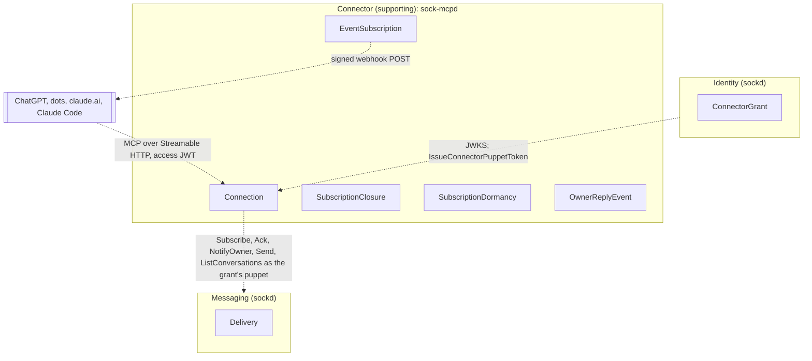
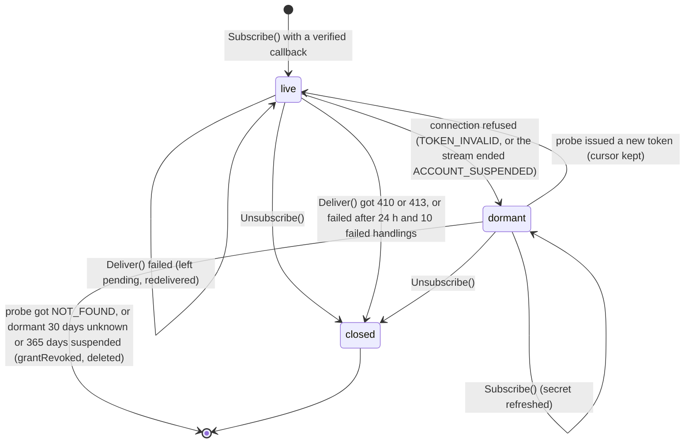
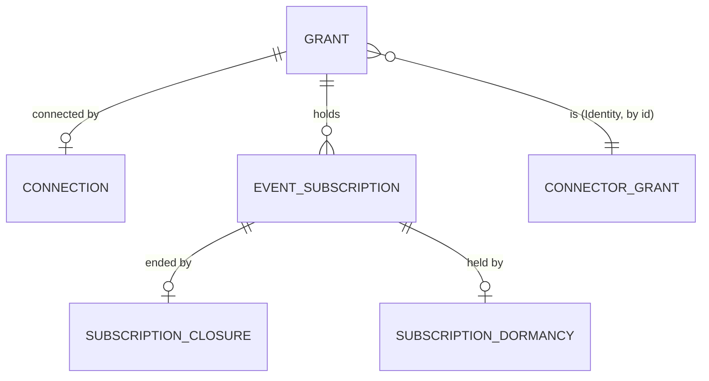

# sock-mcpd: the Connector service

Pass 1. Decisions: [ADR 11](https://github.com/aeryx-ai/sock-contract/blob/main/docs/adr/0011-agent-platforms-connect-through-oauth.md) in `sock-contract` (Identity's authorization server and the connector grant). Language: the `sock-contract` [context map](https://github.com/aeryx-ai/sock-contract/blob/main/docs/specs/context-map.md). The service is the Connector bounded context: an OAuth-connected agent platform talking to sock over MCP. Conformist downstream of Identity (OAuth, `IssueConnectorPuppetToken`) and Messaging (an ordinary puppet caller per grant). Supporting subdomain. It holds no human identity and no message history.

Out: the plugin directory listing package and client setup ([integrations](integrations.md), "Hosted connector"), the authorization server (`sockd`), hooks of any kind, claude.ai inbound.

## Contexts



Across the boundary: grant ids and puppet tokens from Identity, deliveries from Messaging, event payloads to a platform. Never a human account id, a handle or an Apple identifier.

## Connection

Entity, aggregate root. `sock-mcpd`'s view of one connector grant: the puppet it acts as and the credential for it. Created the first time a request arrives with an access token for a grant this service has not seen; one per grant.

### Fields

| Field | Type | Meaning |
|---|---|---|
| `grantId` | UUID | The access token's `sub`. Identity within the service |
| `puppetTokenCiphertext` | bytes | The grant's `sock_pt_` token, AES-256-GCM under `SOCK_MCPD_TOKEN_KEY`, nonce prefixed, with `conn:<grantId>` as additional data so the ciphertext opens only in its own row. Never logged, never returned |
| `puppetId` | UUID | From `sock whoami` with that token, for the sender gate |
| `ownerId` | UUID | `account.puppet.ownerId` from the same call: the only sender whose messages become events |
| `createdAt` | Timestamp | |

Closure is not a field. A connection whose puppet token the hub refuses is deleted and its live subscriptions go dormant (`SubscriptionDormancy`), not closed: `TOKEN_INVALID` on the stream or a tool call, or a stream the hub ends `ACCOUNT_SUSPENDED`. The refusal cannot say which happened (the owner suspended, the connector device removed, the grant revoked), so the grant's next request asks `IssueConnectorPuppetToken` (ADR 11, implementation notes); a tool call that met it asks at once, within the same request, and reruns it once on a fresh device when that is safe. A grant revoked for good is deleted with all its subscriptions; nothing of it is kept for the 30-day closure sweep.

### Behaviors

- `Open(accessToken)` (factory): verifies the JWT, calls `IssueConnectorPuppetToken` with the service token and the JWT, calls `whoami` with the result, stores the ciphertext, puppet id and owner id. On `ALREADY_ISSUED` (a previous instance of this service held it and lost the database) it calls `RevokeConnectorDevice` with the same JWT and issues again, logging the recovery for the operator. It runs for a grant's first request and for its first request after a refusal, which is the dormancy probe: a new token resumes the grant's dormant subscriptions in the same transaction that stores it (their cursors kept) and starts the stream (that stream check runs in the background and retries with backoff until it succeeds); `ACCOUNT_SUSPENDED` leaves them dormant and marks an `unknown` dormancy `suspended`; `NOT_FOUND` (grant revoked, or kept by a revocation) deletes the grant with every subscription, which ends them `grantRevoked`. Concurrent first requests for a grant share one issue
- `Call(tool, input)`: `sock_whoami`, `sock_list_conversations`, `sock_send` with the puppet token, through the `sock-mcp` tool implementations
- `Stream()`: one `Subscribe` on the puppet token, reconnecting with the CLI's backoff, held open while the connection has at least one live `EventSubscription`; otherwise not opened (nothing to deliver to), so deliveries wait in the hub's queue. A delivery that fails to be handled (the store unavailable, an ack refused) ends the stream attempt, which backs off and reconnects: the hub then redelivers from its queue in order, so nothing behind the failed delivery is handled before it. A hub message this service cannot read (an id that is not a UUID) is logged, left unacked and skipped while the stream goes on: it can never pass the sender gate, so it never becomes an event, holding the stream for it would stop the grant's deliveries until the hub is fixed and it comes back with every new stream, so the log keeps naming it. One stream per connection with a live subscription, and no cap: the number of streams is bounded by the number of grants and nothing else. Stopping a stream rechecks the subscriptions once it has ended, so a fresh connection that subscribed while the old stream was still running gets its stream
- `Deliver(delivery)`: the sender gate, then one `OwnerReplyEvent` per live subscription; `Ack` after every subscription accepted it (2xx) or was closed trying
- `Dormant()`: makes every live subscription dormant and deletes the connection, in one transaction, only while the stored connection is still the one this `Dormant` was opened from (same token ciphertext). A stale stream or a slow refusal never deletes a connection a refresh made since

### Invariants

- One connection per grant; the puppet token is held once and only as ciphertext.
- A delivery whose `senderId` is not `ownerId` never becomes an event; it is acked and dropped (the runner's rule).
- A delivery is acked only after every live subscription accepted it; a subscription that fails terminally (410, 413, four failed attempts) is closed first, so a dead webhook never holds the queue.
- No message body is stored; the delivery lives in memory between the stream and the webhook.

### Relationships

| With | Kind | Cardinality |
|---|---|---|
| `EventSubscription` | has-a | 1 to n, n ≥ 0 |
| `ConnectorGrant` (Identity) | references, by `grantId` | 1 to 1 |

## EventSubscription

Entity, owned by `Connection`. A platform's webhook registration for one event on this connection, made by `events/subscribe`.

### Fields

| Field | Type | Meaning |
|---|---|---|
| `id` | UUID | Returned to the platform; `X-MCP-Subscription-Id` on every delivery |
| `grantId` | UUID | |
| `event` | `EventName` | `owner.reply`, the only event in v1 |
| `webhookUrl` | string | `https` on port 443 only (no other port, no userinfo), public address only (checked at subscribe time and again before each delivery), at most 2048 characters as stored: the normalized URL, which percent-encodes what the raw one carried bare, is checked before the verification POST |
| `secretCiphertext` | bytes | The platform's `whsec_` secret (24 to 64 bytes decoded), encrypted like the puppet token with `sub:<id>` as additional data; signs every delivery |
| `cursor` | int64 | The number of events this subscription delivered and the platform accepted, 0 at creation; returned on subscribe and re-subscribe. It is a progress count, not a replay position: the hub queue is the replay mechanism (an undelivered message comes back on the next stream), and a cursor sent on subscribe is accepted and ignored, whatever its type (OpenAI's events page gives it none) |
| `createdAt` | Timestamp | |

Closure is not a field. A closed subscription has a `SubscriptionClosure` row.

### Behaviors

- `Subscribe(event, webhookUrl, secret, cursor)` (factory): validates the URL and secret, runs the callback verification (`{"type":"verification","challenge"}` signed; the webhook must echo the challenge or the subscribe fails with JSON-RPC `-32015`), returns `id`, `cursor`, `refreshBefore` (null: no expiry) and `truncated` false. A host that does not resolve and one that resolves to a non-public address get the same answer, `-32015` with `data.reason` `callback_unreachable`, so subscribe is no probe of what resolves where; the detail goes to the log only, without the URL's query. A connection holds at most 10 live subscriptions: an 11th is `-32602` (a refresh of a live one still succeeds), decided under the per-grant subscribe lock. A new callback past the cap is refused before its verification, so no challenge is posted for it, and each verification POST takes one of the webhook delivery slots
- `Deliver(event)`: one POST, body `{eventId, name, timestamp, data, cursor}`, at most 256 KiB, headers `webhook-id`, `webhook-timestamp`, `webhook-signature` (Standard Webhooks HMAC-SHA256 over `id.timestamp.body`), `X-MCP-Subscription-Id`; `2xx` acknowledges; `410` and `413` close the subscription at once; anything else retries with the same `eventId`, after the answer's `Retry-After` (delta-seconds or HTTP-date; a past date or garbage falls back) or else backoff 1, 2, 4 s, and ends `Failed` after four attempts or at once on a `Retry-After` over 30 s. `Failed` leaves the delivery pending: the other subscriptions are still offered it, then the hub delivery is not acked, the stream attempt ends and the hub redelivers in order, after at least the wait the platform asked for, capped at 5 min; a subscribe or unsubscribe on the grant ends that wait at once. A subscription already failing gets one attempt per redelivery, no retries inside it, so a hung callback holds a delivery slot for one timeout a cycle. The redelivery skips each subscription whose last accepted event is this one, so no second POST and no second cursor step. An Accepted whose write fails is POSTed again on the redelivery, with the same `webhook-id`. A subscription closes `deliveryFailed` on a failure once it has been failing 24 h (since its first failure, reset by an accept) and for at least 10 failed handlings, so downtime alone does not close it; the owner is notified and it no longer holds the ack. The cost: while one subscription fails, the grant's other subscriptions wait for the events behind it, since a grant has one stream and it delivers in order. An event whose own body would exceed 256 KiB is `Dropped`: never sent, the delivery acked, the subscription kept and the event id logged, since the platform did nothing wrong
- `Unsubscribe()`: closes with `unsubscribed`. The platform names the subscription by `name`, `arguments` and `delivery.url`, as OpenAI's events page has it, with `delivery.mode` optional (an `id` is accepted too); one already closed is a repeat and succeeds, one never made (or another connection's) is JSON-RPC `-32004` on HTTP 200, since an HTTP `404` on Streamable HTTP means an unknown session and sends the client to initialize again

### Invariants

- The secret decrypts only to sign a delivery and is never returned, logged or echoed.
- Deliveries to one subscription follow the hub stream order, including across a failed handling (the stream attempt ends and the hub redelivers in order); `cursor` increases by one per accepted event and never decreases. `seq` is per conversation and travels in `data`, never as the cursor.
- A subscription outlives its connection: it hangs off the grant, goes dormant when the connection is refused and ends only by its own closure or the grant's deletion (`NOT_FOUND` on the probe, or dormant past its cause's bound with no request: 30 days `unknown`, 365 `suspended`).
- No subscription is live without a connection: a subscribe for a grant whose connection is gone inserts it dormant, with the grant's cause and `since`.

### States



Anything not drawn is refused. Dormant is not live: no stream delivers to it, the hub queues its events, and the live gauge, the boot and the fan-out leave it out. It is not closed either, so subscribe and unsubscribe still find it. A request only reaches them after its `Open` probed the grant, which resumes a dormant subscription before the call runs; a dormant one is met only when a refusal lands between that `Open` and the call. Then `Subscribe()` on its grant, event and URL is a refresh as for a live one (same id and cursor, new secret) and it stays dormant, because the token the request loaded is the refused one and only the next probe can tell; it counts toward the 10, since it resumes. `Unsubscribe()` closes it `unsubscribed`, as it would a live one, since the platform asked to stop. A new subscription in that window, for a callback the grant has none for, is inserted dormant with the grant's cause and first `since`, never live with no connection: the subscribe holds the grant row shared, so a refusal waits for it and makes it dormant with the rest, and one that committed first is seen. A grant deleted in that window (revoked, or swept) refuses the subscribe as an internal error; the platform's next request probes.

### Relationships

| With | Kind | Cardinality |
|---|---|---|
| `Connection` | owned by | n to 1 |
| `SubscriptionClosure` | has-a | 1 to 0..1 |

## SubscriptionClosure

Value object, owned by `EventSubscription`, 0 or 1. Why a subscription ended.

| Field | Type | Meaning |
|---|---|---|
| `subscriptionId` | UUID | |
| `cause` | `ClosureCause` | `unsubscribed`, `gone` (410), `tooLarge` (413), `deliveryFailed`, `grantRevoked` |
| `closedAt` | Timestamp | |

When a subscription closes for `gone`, `tooLarge` or `deliveryFailed`, the connection posts one `NotifyOwner` as its puppet: "<platform> stopped receiving your replies"; the owner reconnects from the platform. Closed rows are kept 30 days for the operator, then swept. `grantRevoked` is never a row: a revoked grant is deleted with its subscriptions.

## SubscriptionDormancy

Value object, owned by `EventSubscription`, 0 or 1. The grant's puppet token was refused and no new one has been issued.

| Field | Type | Meaning |
|---|---|---|
| `subscriptionId` | UUID | |
| `since` | Timestamp | When the connection was first refused. Never moved: a later refusal or probe keeps it |
| `cause` | `DormancyCause` | `suspended`: the hub said so, as a stream ended `ACCOUNT_SUSPENDED` or a probe's issue answered it. `unknown`: a `TOKEN_INVALID`, which a suspension, a removed device and a revocation all give |

Written by `Connection.Dormant()` for every live subscription of the grant, with `suspended` when the stream ended `ACCOUNT_SUSPENDED` and `unknown` otherwise, and deleted by the probe's new token. A probe answering `ACCOUNT_SUSPENDED` updates `unknown` to `suspended` and keeps `since`. Nothing probes on its own: the hub is asked only on a request from the platform, so a suspended grant sits untouched until its platform calls.

The sweep deletes every grant that has no connection and a subscription dormant past its cause's bound, as a `NOT_FOUND` would: 30 days `unknown`, since a revoked grant's platform never calls again and no probe ever settles it, and 365 days `suspended`, since the owner may be reinstated and the platform cannot refresh, so cannot probe, while suspended. Both count from `since`, the first refusal, so an `unknown` row turned `suspended` on day 20 still goes on day 365 and a grant stays dormant 365 days at most. An owner erased while suspended never comes back, and the 365-day bound is what deletes their grant's subscriptions, webhook URLs and sealed secrets. A reinstatement after day 365 needs the platform to subscribe again. The sweep also deletes a grant with no connection and no subscriptions once its row is 30 days old: it holds nothing.

It runs at startup and whenever a grant's stream ends, in the background beside the streams (one at a time; one asked for meanwhile follows once), never in a stream's restart path. Each run deletes at most 100 grants a transaction until none is left, under a 1 min deadline, and rechecks age and connection in the delete itself, after locking the grant rows, so a grant that resumed or went dormant anew since the read is kept. The daily closure sweep also runs it, as a backstop to the event triggers: a deployment where no stream ends for weeks still enforces the bounds.

## OwnerReplyEvent

Value object, never stored. One owner delivery as a platform sees it.

| Field | Type | Meaning |
|---|---|---|
| `eventId` | string | The delivery's message id; the same id on every retry and on every subscription, so platforms dedupe |
| `name` | string | `owner.reply` |
| `timestamp` | RFC 3339 | The message's `sentAt` |
| `data.conversationId` | UUID | |
| `data.messageId` | UUID | |
| `data.seq` | int64 | |
| `data.text` | string | The owner's Markdown, as sent, up to 65536 bytes |
| `cursor` | int64 | The subscription's accepted-delivery count after this event |

The event schema (`payloadSchema` in `events/list`) is this object's `data`, which is what OpenAI's events page says `payloadSchema` describes; `inputSchema` for `events/subscribe` is empty: a subscription covers every reply to the connection's puppet.

## Enumerations

`EventName`: `owner.reply`.

`ClosureCause`: `unsubscribed`, `gone`, `tooLarge`, `deliveryFailed`, `grantRevoked`.

`DormancyCause`: `suspended`, `unknown`.

## Everything at once



## Transport and auth in

- `POST https://mcp.sock.aeryx.ai/mcp`, MCP over Streamable HTTP, protocol revision `2026-07-28` (events need it; the Go MCP SDK's support for the revision's discovery handshake is the first thing the implementation plan checks) with the legacy `initialize` accepted for clients that still send it. Stateless, JSON framing: every answer is one `application/json` body (an array for a batch), never an SSE stream (the SDK's `JSONResponse`).
- The envelope in front of the SDK routes and charges on its own read of each message and never forwards what it cannot read the way the SDK reads it. Invalid JSON is `-32700` and an empty batch `-32600`, for the whole body. A request or batch element with a repeated or case-variant `jsonrpc`, `id`, `method` or `params` key (decoders disagree on both: `encoding/json` folds case, the SDK does not), `jsonrpc` other than `"2.0"`, a `method` that is not a string, an `id` that is not a string, null or an integer the SDK writes back unchanged (canonical form within 2^53: the SDK truncates `1.5` to `1` and writes `1e0` as `1`), or `params` that is not an object, array or null is `-32600`: a single request is answered alone, a batch element in the batch's answer with `id` null while the rest run. Whole-body refusals answer HTTP `400` with one JSON-RPC error and `id` null.
- `GET /.well-known/oauth-protected-resource/mcp` and `GET /.well-known/oauth-protected-resource` (RFC 9728): `resource` = `https://mcp.sock.aeryx.ai/mcp`, `authorization_servers` = [`https://api.sock.aeryx.ai`], `scopes_supported` = [`sock`], `bearer_methods_supported` = [`header`].
- `GET /.well-known/openai-apps-challenge`: the exact token OpenAI's portal gives, as `text/plain`.
- `GET /healthz`: 200 when the database answers, 503 otherwise, no data. The ping runs under a 2 s timeout and its result is reused for 2 s, so a flood of hits is one ping every 2 s.
- Every `/mcp` request carries `Authorization: Bearer <access JWT>`. Verified offline against the hub's JWKS (refreshed every hour and on an unknown `kid` at most once a minute, since keyfunc does not honor `Cache-Control`, so a withdrawn key stays trusted up to an hour): ES256, `iss` = `SOCK_MCPD_ISSUER` (the hub's public issuer, which is not the URL this service reaches it on), `aud` = this resource exactly (a single member: a token whose `aud` also names another resource is refused), `exp`, `scope` contains `sock`. Missing or invalid: `401` with `WWW-Authenticate: Bearer resource_metadata="https://mcp.sock.aeryx.ai/.well-known/oauth-protected-resource/mcp"`; a valid token without the scope: `403` with `error="insufficient_scope"`. Nothing else is accepted: no API keys, no puppet tokens, no cookies.
- The `sub` names the connection. The first request for a `sub` with no stored connection (a new grant, or one refused since) opens it (`Connection.Open`), which is the only call that costs a hub round trip for identity; later requests use the stored ciphertext. A refusal of that issue for a revoked grant or a suspended owner is kept in memory per grant (bounded, the soonest to expire evicted first) until the presenting JWT's `exp` (a suspension at most one minute) and answered again without a hub call to any JWT of the grant that expires no later, so a client retrying a live JWT costs one call a minute at most from the connector service's shared 60 a minute, not one per request. Keeping it logs one `WARN` line; the requests it then answers log nothing. A suspended owner gets no `401` and so keeps its JWT, which is why a suspension is asked again after a minute: a reinstatement shows within that, and the platform's refreshed JWT, expiring later, issues at once.
- A suspended owner (`ACCOUNT_SUSPENDED` on the issue, kept or fresh) is never answered `401`, `502` or a `WWW-Authenticate` challenge, any of which would make the platform refresh or drop its tokens (sock server ruling, 2026-10-14). A `tools/call` answers a JSON-RPC result with `isError: true` and the fixed text `Your sock account is suspended. Contact support.`, counted `refused`, with no hub call; `initialize`, `tools/list`, `events/list` and the rest answer normally, in a batch too; a request carrying `events/subscribe`, which cannot be served, answers `403`. The platform's connection and tokens survive, and the first request after reinstatement (within the minute above) issues a fresh device and resumes the subscriptions.

## Tools

The three sending tools, linked from `sock-mcp` as a library in outbound-only form: `sock_whoami`, `sock_list_conversations`, `sock_send`. Same names, schemas and descriptions as the stdio server, pinned by the drift test in `test/`. Every tool declares `securitySchemes: [{type: oauth2}]` for the OpenAI package. No `sock_fetch`, no `sock_ack`: this service is the single consumer of every connector puppet's deliveries. Per-grant limits are the hub's (60 sends a minute per puppet); the service adds a request limit of 120 a minute per grant, answering `429` with `Retry-After`. Each element of a batch counts against it, counted from the array before any element is decoded. A batch with more elements than the limit (121 or more) can never be admitted and is refused at once with one `-32600`, charging only its request; a smaller batch that would exceed what is left of the window is refused `429` as a whole. Outbound, at most 20 webhook POSTs (deliveries and verifications) are in flight per instance; a delivery over that waits for a slot (logged), and a backoff wait between attempts holds none.

## Events

- A batch that carries any `events/*` request holds at most 10 elements; a larger one is answered with one `-32600` for the whole batch. Each events request runs under a 30 s deadline, and every request, a single one or a batch, under one 50 s deadline from its arrival, covering a first connection open (whose issue it also bounds) and the request or every element together, inside the HTTP server's 60 s write timeout (JSON framing: no long streams on `/mcp`); an element the batch deadline cuts short is answered with an error, and an open it cuts short refuses the request before any of it runs.
- Capability `events` in the discovery result. `events/list` returns `owner.reply` with `delivery: ["webhook"]`, the empty `inputSchema` and the `payloadSchema` above. `events/subscribe` and `events/unsubscribe` as `EventSubscription` says. All three on the same authenticated endpoint as the tools; a subscription belongs to the connection the access token names, and `events/unsubscribe` of another connection's subscription is `-32004`.
- The connection's stream opens with its first live subscription and closes with its last. Each delivery: gate, fan out, ack. The hub holds deliveries up to 30 days and redelivers on reconnect, so a platform outage shorter than that loses nothing.
- The grant is re-checked by use: a `TOKEN_INVALID` from the hub on the stream (a live one or its first `Subscribe`) or on a tool call, or a stream ended `ACCOUNT_SUSPENDED`, makes the connection dormant (`Dormant` bound to the connection that met it). On a tool call that also stops the connection's stream and probes at once with the request's JWT: a suspension (the hub deletes the device when it suspends the owner, so a live connection's call sees `TOKEN_INVALID`) answers the request without a `401`: whatever already ran keeps its real result (a send the hub accepted, a stored subscribe), and only the calls the hub refused answer the suspended text; a fresh connection resumes the subscriptions and their stream, and the request runs once more on it and is answered normally; a revoked grant deletes them and answers `401`. That rerun is made once, and only when nothing the request did can have been accepted: the request changed no subscriptions (no `events/subscribe` or `events/unsubscribe`), and every attempt of every write (`Send`, `NotifyOwner`) was refused `TOKEN_INVALID`. Such a write never reached the hub's handler: its auth interceptor refuses before the handler runs, and its after-call device re-check skips mutating procedures. A write that succeeded, or an attempt that failed some other way before the client's own retry met `TOKEN_INVALID`, may have been accepted, and a rerun would mint a new idempotency key and send twice. Without a rerun, or when the rerun is refused `TOKEN_INVALID` too, the request answers `401` with `WWW-Authenticate: Bearer error="invalid_token"`, so the platform authorizes again. Off a tool call the next request probes the same way: a fresh connection resumes them, a suspension keeps them dormant and is answered as a suspended owner's, a revoked grant deletes them and answers `401`.

## State

Postgres, schema `connector`, Postgres types, numbered migrations. No JSON columns. The two secrets at rest are ciphertext under `SOCK_MCPD_TOKEN_KEY` (32 bytes, from the deployment's secret store, never in the database), each bound to its row with additional data (`conn:<grantId>`, `sub:<subscriptionId>`): a ciphertext copied into another row does not open.

```sql
CREATE SCHEMA connector;

CREATE TABLE connector.connections (
    grant_id                 uuid        PRIMARY KEY,  -- REFERENCES connector.grants ON DELETE CASCADE, migration 00004
    puppet_id                uuid        NOT NULL,
    owner_id                 uuid        NOT NULL,
    puppet_token_ciphertext  bytea       NOT NULL CHECK (octet_length(puppet_token_ciphertext) BETWEEN 29 AND 256),
    created_at               timestamptz NOT NULL DEFAULT now()
);

CREATE TABLE connector.event_names (name text PRIMARY KEY);
INSERT INTO connector.event_names VALUES ('owner.reply');

CREATE TABLE connector.event_subscriptions (
    id                 uuid        PRIMARY KEY DEFAULT uuidv7(),
    grant_id           uuid        NOT NULL REFERENCES connector.connections (grant_id) ON DELETE CASCADE,
        -- migration 00004 points it at connector.grants
    event              text        NOT NULL REFERENCES connector.event_names (name) ON DELETE RESTRICT,
    webhook_url        text        NOT NULL CHECK (char_length(webhook_url) BETWEEN 9 AND 2048 AND webhook_url LIKE 'https://%'),
    secret_ciphertext  bytea       NOT NULL CHECK (octet_length(secret_ciphertext) BETWEEN 29 AND 128),
    cursor             bigint      NOT NULL DEFAULT 0 CHECK (cursor >= 0),
    created_at         timestamptz NOT NULL DEFAULT now()
);
CREATE INDEX event_subscriptions_grant_idx ON connector.event_subscriptions (grant_id);
    -- serves fan-out per delivery and "does the connection have a live subscription"

CREATE TABLE connector.closure_causes (name text PRIMARY KEY);
INSERT INTO connector.closure_causes VALUES ('unsubscribed'), ('gone'), ('tooLarge'), ('deliveryFailed'), ('grantRevoked');

CREATE TABLE connector.subscription_closures (
    subscription_id  uuid        PRIMARY KEY REFERENCES connector.event_subscriptions (id) ON DELETE CASCADE,
    cause            text        NOT NULL REFERENCES connector.closure_causes (name) ON DELETE RESTRICT,
    closed_at        timestamptz NOT NULL DEFAULT now()
        -- a closed subscription and its closure are swept 30 days after closed_at
);

-- migration 00002
CREATE TABLE connector.subscription_last_accepted (
    subscription_id  uuid  PRIMARY KEY REFERENCES connector.event_subscriptions (id) ON DELETE CASCADE,
    message_id       uuid  NOT NULL
        -- the last event the platform accepted; written in the statement that steps cursor, so a
        -- redelivery skips it. Its own row since a subscription has none before its first accept
);

CREATE TABLE connector.subscription_failing (
    subscription_id  uuid        PRIMARY KEY REFERENCES connector.event_subscriptions (id) ON DELETE CASCADE,
    since            timestamptz NOT NULL
        -- set by the first failure, deleted by an accept
);

-- migration 00003
ALTER TABLE connector.subscription_failing ADD COLUMN attempts int NOT NULL CHECK (attempts >= 1);
    -- failed handlings since since; a failure closes deliveryFailed once since is 24 h old and attempts is at least 10

-- migration 00004
CREATE TABLE connector.grants (
    grant_id  uuid  PRIMARY KEY
        -- a grant this service holds state for; written with its first connection, deleted on NOT_FOUND
        -- or by the dormancy sweep, cascading to its connection and subscriptions
);
-- filled from connector.connections, then:
ALTER TABLE connector.connections ADD FOREIGN KEY (grant_id) REFERENCES connector.grants (grant_id) ON DELETE CASCADE;
ALTER TABLE connector.event_subscriptions DROP CONSTRAINT event_subscriptions_grant_id_fkey,
    ADD FOREIGN KEY (grant_id) REFERENCES connector.grants (grant_id) ON DELETE CASCADE;
    -- a subscription outlives its connection, so a refused one can go while its subscriptions wait

CREATE TABLE connector.subscription_dormancy (
    subscription_id  uuid        PRIMARY KEY REFERENCES connector.event_subscriptions (id) ON DELETE CASCADE,
    since            timestamptz NOT NULL
        -- written when the connection is refused, deleted by the next stored connection
);
CREATE INDEX subscription_dormancy_since_idx ON connector.subscription_dormancy (since);
    -- serves the sweep of grants dormant past their bound

-- migration 00005
ALTER TABLE connector.grants ADD COLUMN created_at timestamptz NOT NULL DEFAULT now();
CREATE INDEX grants_created_at_idx ON connector.grants (created_at);
    -- serves the sweep of grants holding nothing, 30 days after created_at; rows from before count from the migration

-- migration 00006
CREATE TABLE connector.dormancy_causes (name text PRIMARY KEY);
INSERT INTO connector.dormancy_causes VALUES ('suspended'), ('unknown');
ALTER TABLE connector.subscription_dormancy
    ADD COLUMN cause text NOT NULL REFERENCES connector.dormancy_causes (name) ON DELETE RESTRICT;
    -- rows from before the migration are unknown; the sweep keeps suspended 365 days, unknown 30, from since
```

Unclosed is derived: no closure row. Live is derived: unclosed and no dormancy row. Stream open is replica memory, never stored.

## Security

Review gate before anything ships, fresh context, verified by reproduction: token confusion (`aud` of another resource, `iss` of staging against production, an unsigned or `none` algorithm token, an expired token), scope handling, the sender gate (a non-owner member of a group the connector puppet is in must never produce an event), SSRF on webhook URLs (`https` only, public addresses re-resolved before every POST, no redirects followed), webhook secret and puppet token at rest (ciphertext only; the key never in logs or the database), cross-grant leakage (an event never reaches another connection's subscription; `events/unsubscribe` across connections is `-32004`), replay of webhook verification, request limits per grant, and the `ALREADY_ISSUED` recovery path (`RevokeConnectorDevice` then a second issue, never a loop).

Logging: grant id, subscription id, event id and outcomes; never a token, a secret, a URL's query string or the text.

Observability (sock-contract ADR 14). Logs, metrics and traces go over OTLP/HTTP to Grafana Cloud, configured only by the standard `OTEL_*` variables and `OTEL_EXPORTER_OTLP_HEADERS_FILE`, read as the other `_FILE` secrets are and winning over `OTEL_EXPORTER_OTLP_HEADERS`; with no `OTEL_EXPORTER_OTLP_ENDPOINT` nothing is exported and nothing is required. Export runs through bounded batching queues, so an outage costs telemetry, never a request, and shutdown flushes within the existing grace. Logs on stderr are JSON lines (slog's JSON handler), and the `otelslog` bridge sits beside that handler beneath the redactor, so an exported log record is the redacted line. The header value (the Grafana token) is a `sync: false` secret, never logged: each header value, raw and decoded, is a redaction literal before the first log line, and with the `_FILE` form set the `OTEL_EXPORTER_OTLP_*HEADERS` variables are cleared, so otel's own parser, which logs a malformed pair raw outside the redactor, never reads them; without it, a malformed `OTEL_EXPORTER_OTLP_HEADERS` or per-signal form (anything otel would reject: a pair with no `=`, a name that is no RFC 9110 token, a bad escape) refuses startup before that parser runs, with an error naming only the variable and the header's position. The startup line says only whether it is set.

- Standard signals: Go runtime, process and host (CPU, memory, file descriptors, network), HTTP server and client duration, request and response sizes and requests in flight (`/mcp`, the well-known routes, the webhook client, the hub client and the JWKS fetch, which goes through the hub client's transport and User-Agent), hub RPC duration per procedure, Postgres pool stats and query duration.
- The service's own: connections stored and live subscriptions (gauges); tool calls by tool and outcome (`ok`, `error`, `refused`); puppet token issues by outcome (`issued`, `recovered`, `revoked`, `failed`); webhook deliveries by outcome (`accepted`, `gone`, `too_large`, `failed`, `dropped`, `canceled`); delivery slot wait (histogram), slots in use and POSTs waiting with the oldest wait; hub streams open; pending deliveries and the oldest one's age, which keeps aging across replays so an alert catches a grant stuck behind a store or hub error; limiter refusals by reason (`rate`, `batch`) and the grants the limiter tracks.
- Labels from a fixed set only, enforced by a view on every instrument: the RPC and HTTP keys whose values are a small closed set, `rpc.method` (otelconnect folds the service into it, so no `rpc.service`), `rpc.response.status_code`, `rpc.connect_rpc.error_code`, `rpc.system.name`, `http.request.method`, `http.route` (the mux pattern, never the path) and `http.response.status_class` (`1xx` to `5xx`, while spans keep the code; no `error.type`), the runtime and host enumerations `go.memory.type`, `cpu.mode`, `system.memory.state` and `network.io.direction`, then `outcome`, `reason`, `tool` (a registered tool or `unknown`) and `peer.service` (`sock-hub` or `webhook`). Never a grant, puppet, subscription, message or event id, a webhook host or URL, a peer address or a user agent. Exemplars are off, since they keep what the view drops.
- Traces are head-sampled (`parentbased_traceidratio` at 0.1 on Render), so error traces are sampled at the same ratio as the rest; errors are always in metrics and logs. A server span per request named by route pattern and JSON-RPC method (`POST /mcp tools/call`, never params); client spans for hub RPCs (trace context goes to the hub) and webhook POSTs (none goes to a platform; a caller's `traceparent` is ignored too). A filter before the exporter keeps an allow-list of span attributes: no URL, query, host, client address or user agent, no error text, no message text, token or secret.

Log leaks the redactor cannot catch (free text with no secret shape):

- Webhook transport errors are logged as a closed class only (`error_class`: `timeout`, `tls`, `refused`, `dns`, `reset`, `other`), never the error text. The text carries the platform's host (a certificate name check) and the resolved IP (a dial error). The verification error carries the class too.
- The `http.Server` error log and the `log` package go to stderr through the redactor, never the OTLP exporter: a panic's value, stack and the peer address are free text. `slog.SetDefault` points the `log` package at the bridge, so startup sets its output back to stderr. `/mcp` recovers a handler panic and logs the method, the route and `handler panic`.
- Configured secrets (`SOCK_ACCESS_GATE` when set, the service token) are literal redactions, registered at startup, since an upstream error can echo a header in a shape no pattern matches.

## Testing

Go, in this repository's `test/` module to start, moving with the service into its own repository when it is scaffolded:

- A fake hub (`httptest`): JWKS, `IssueConnectorPuppetToken`, `whoami`, `Subscribe` stream, `Ack`, `NotifyOwner`, `Send`, with scripted deliveries and failures.
- A fake platform: a webhook receiver that answers the verification challenge, 2xx, 410, 413, 5xx and timeouts, and checks signatures.
- Cases: every auth refusal above; a connection opened once per grant; tool calls as the puppet; subscribe with a failing callback is refused; a delivery from the owner reaches every live subscription in order, signed, and is acked after the last 2xx; a non-owner delivery is acked and produces no event; 410 and 413 close the subscription and the owner is told once; a failure leaves the delivery pending and the redelivery skips the subscriptions that accepted it; 24 h and 10 failed handlings close it `deliveryFailed`; the platform's wait is capped at 5 min and a subscribe or unsubscribe ends it; `Retry-After` in both forms, garbage, a past date and one over 30 s; the stream opens with the first subscription and closes with the last; a revoked grant closes the connection; cursors resume; a stream ended `ACCOUNT_SUSPENDED` or `TOKEN_INVALID`, and a tool call's `TOKEN_INVALID`, leave the subscriptions dormant, not closed; suspend then reinstate resumes them with the cursor kept, while a kept suspended refusal answers the same JWT without a hub call and a later JWT issues; suspend then revoke deletes them; `TOKEN_INVALID` on the first `Subscribe` (a deleted token at boot) goes dormant and the next request resumes it; concurrent requests during reinstatement share one issue and one stream; the sweep at boot, at a stream end and on the daily tick deletes a grant past its bound and keeps a recent one; unknown dormancy goes after 30 days and suspended after 365, both from the first refusal, and a suspended probe marks unknown suspended with `since` kept; nothing probes the hub without a platform request; the sweep runs in batches, rechecks the age in its delete, keeps a grant a new connection races (which fails without the lock before the recheck), deletes a bare grant past 30 days and never delays a stream's restart; a subscribe with no connection, or racing a refusal, is dormant, never a live orphan; a failed stream check after a new connection is retried; migration 00006 backfills unknown and refuses a cause outside the vocabulary; subscribe and unsubscribe match a dormant subscription; migration 00004 keeps rows from before it; the request limit; secrets never appear in logs; the drift test pins the three tools.
- Contract tests against staging `sockd` for `IssueConnectorPuppetToken`, the JWKS and the stream, with a staging grant.
- Live, in order, as [integrations](integrations.md) says: tool discovery over the Secure MCP Tunnel with the stdio server, the staging endpoint as a custom MCP server in ChatGPT and as a claude.ai connector, an owner reply arriving at a dot, then the directory submission.

## Deployment

Scaffolded from rookery as `sock-mcpd` (daemon plus a small CLI for the service token and the challenge file), Go, Postgres, on `mcp.sock.aeryx.ai` (staging `stage-mcp.aeryx.ai`). Hosted on Render beside the hub, each environment a Render web service with its own Render Postgres (`sock-mcpd-staging`, `sock-mcpd`), so it rides the hub's pipeline unchanged: the image pushed to GHCR by digest and signed keyless by `ci.yml` on `main`, staging deployed and smoked on every `main` push, production promoted only by a `v*` tag through the release gate, and render.yaml held to the live services by `render-drift`. The setup is sock-mcpd's `deploy/cloud/README.md`. Configuration: `SOCK_URL`, `SOCK_MCPD_ISSUER`, `SOCK_MCPD_RESOURCE`, `SOCK_MCPD_SERVICE_TOKEN` (`sock_ct_`), `SOCK_MCPD_TOKEN_KEY`, `SOCK_MCPD_DATABASE_URL`, `SOCK_MCPD_OPENAI_CHALLENGE`. The service refuses to start without any of them, with an empty secret (from the variable or its `_FILE`), or with a `SOCK_MCPD_ISSUER` that is not a bare `https` origin (no trailing slash, path, query or userinfo) or a `SOCK_URL` that is not `https` (plain `http` only for a loopback host, a hub under test, or a single-label hostname with no dots, a Render private network name). Optional `SOCK_ACCESS_GATE` (staging) is sent as `Sock-Access-Gate` on hub RPCs and on the JWKS fetch, only to `SOCK_URL`'s host: neither follows a redirect, so a 3xx to another host never carries the gate or the service token. Optional `OTEL_*` (Security, Observability) turns on export.

Issuer versus transport. `SOCK_MCPD_ISSUER` is the hub's public issuer: the `iss` its access tokens carry, checked by the verifier, and the `authorization_servers` entry in the protected-resource metadata. `SOCK_URL` is where this service reaches the hub: hub RPCs and the JWKS (`SOCK_URL` + `/.well-known/jwks.json`). On Render it is the private network (`http://sock-staging:10000` on staging, `http://sock:10000` in production), because Cloudflare Access fronts the public staging hostname and a service cannot pass it, while the tokens still carry the public issuer (`https://stage-api.aeryx.ai`, `https://api.sock.aeryx.ai`). The private network needs both services in the same Render workspace and region (`oregon`). Plain `http` stays inside that network; the service token and puppet tokens never cross the public internet unencrypted.

One instance per environment in v1, never a second replica: the stream per connection, the request limit and the first `Open` are per instance, and a second instance's `Open` would meet `ALREADY_ISSUED` and revoke the first's connector device. On Render that takes `numInstances: 1` and a disk on the service: a zero-downtime deploy runs the old and the new instance together, and a disk turns zero-downtime deploys off, so a deploy stops the old instance before starting the new one.

## Open, not assumed

- Whether the Go MCP SDK's `2026-07-28` handshake and events are enough as of the implementation date, or events need a custom method layer.
- Whether a dot creates the `owner.reply` subscription itself from the user's instruction or ChatGPT does on install; the live dot test decides the install documentation.
- The owner notification on a closed subscription: one `NotifyOwner` per closure as written, or none (the platform shows its own disconnected state).
- Service token rotation: two tokens live during a changeover, or a restart with the new one.
