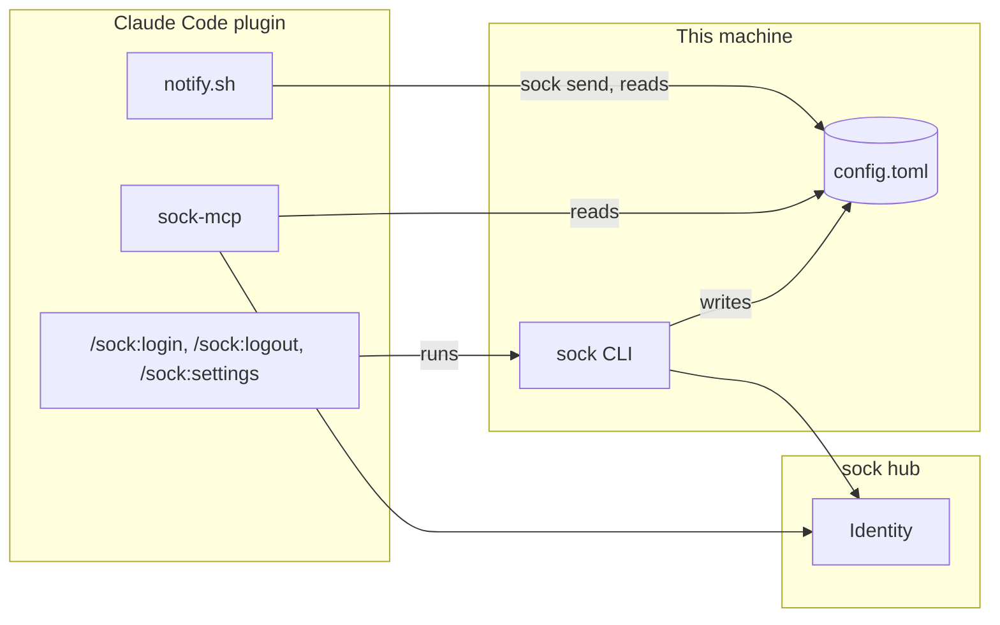
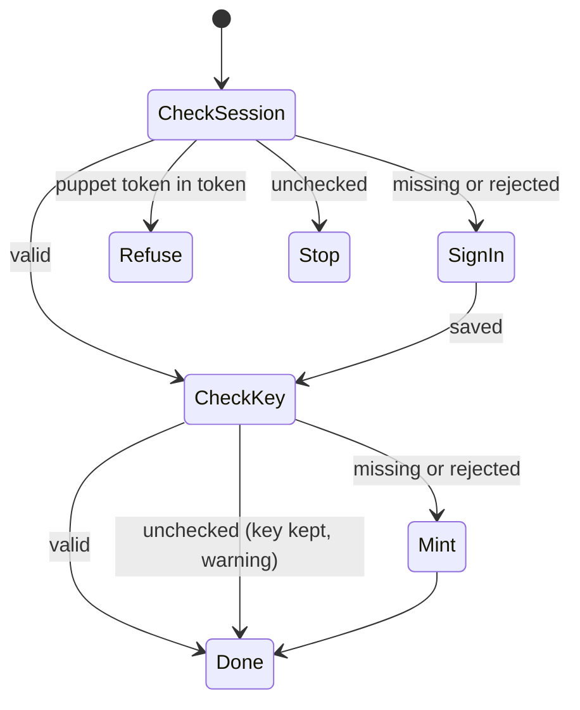

# Plugin sign-in

Bead integrations-9jk, with integrations-vzq. Decisions: [ADR 6](../adr/0006-one-config-file-carries-the-machines-sock-settings.md). Hub contract: sock-contract `api.md` (`StartTerminalSignIn`, `FinishTerminalSignIn`, `SignOut`, `GetMe`, `MintMachineKey`, `ListPuppets`). No hub change.

## Context map

Generic subdomain: credentials on one machine. The sock CLI config file is the one store; sock-client reads it, the sock CLI writes it, sock-mcp and the hooks read it. The plugins hold no credential and no setting of their own beyond the `sock_token` override. Everything is conformist downstream of the hub's Identity contract.

## Language

- session: the human's sign-in, a `sock_st_` token in `token`. Made by `sock login`, ended by `sock logout`.
- machine key: a `sock_mk_` token in `machine_key`. Makes this machine's puppets. Kept by `sock login`.
- owner messaging: whether a puppet on this machine may message the owner without the owner writing first. `message_owner` in the file.
- server: the hub `url` every credential in the file belongs to.
- check: one call to the hub with one credential, answering valid, rejected or unchecked. Derived each time, never stored.

## Domain model

### Config file (entity, identity: its path)

| Field | Type | Meaning |
|---|---|---|
| `url` | string | The server every credential below belongs to. Absent means `DefaultURL`. |
| `token` | string | The session, or a puppet token from an older setup. Absent means signed out. |
| `puppet_token` | string | One puppet for every session (`sock puppets use`). Absent means each session mints its own. |
| `machine_key` | string | Absent means no puppets can be minted here. |
| `access_gate` | string | Staging gate for `url`. Absent means none. |
| `message_owner` | bool | New. Absent means true: the default the plugin option had. |

Invariants: every credential goes only to `url` (existing, `PuppetFileConflict`). `url` changes only while the file holds no credential (new: a credential must never be sent to a server it was not issued by). Written mode 600 under the existing lock.

Behaviors, all on the CLI's `config` package: `SetNewToken`, `RemoveToken`, `SetMachineKey(force)` (existing), `SetMessageOwner(bool)`, `SetURL(url)` (new; refuses while a credential is present).

### Check (enumeration)

`valid`, `missing` (field absent), `rejected` (hub answered `Unauthenticated` or `TOKEN_INVALID`), `unchecked` (no answer: network, timeout, 5xx). Session check: `GetMe` with `token`. Machine key check: `ListPuppets` with `machine_key`, as `machine-key use` checks today.

### Login repair

Anything unlisted is refused. A valid session is never replaced. A valid machine key is never replaced. A rejected session is removed before sign-in starts. A rejected machine key is overwritten without revoking it: the hub no longer accepts it.

## CLI contract (sock-cli)

`sock login` (changed): the repair above. Output lines, stdout:
- `signed in as @<handle> on device <id>` (new sign-in) or `already signed in as @<handle>` (valid session).
- stderr, one of: `machine key works`, `kept a machine key for <label>: each project you open gets its own puppet`, `replaced a machine key the server no longer accepts`, `could not check the machine key (<reason>); kept it`.
- Exit 0 when the session is valid at the end. Exit 1 on refusal, unchecked session or failed sign-in, file untouched.
- Idempotent: a second run with both valid makes no hub write and opens no browser.
- Flags unchanged. `--url` on a file with credentials for another server is refused as today.

`sock logout` (unchanged behavior): signs out the session, removes `token`, keeps `machine_key`. One added stderr line: `the machine key stays: sessions here can still message you; sock settings --message-owner=off stops that`.

`sock settings` (new):
- No flags: prints the report. Text by default, `--json` for the object below. Exit 0 whatever the checks answer: it is a report.
- `--message-owner=on|off`: writes `message_owner`, then prints the report.
- `--url <url>`: writes `url` when the file holds no credential, else exit 1 with `sign out first (sock logout); the credentials here belong to <url>`. A `machine_key` or `puppet_token` counts.
- Report fields: `config` (path), `url`, `session` (check, and `handle` when valid), `machine_key` (check), `puppet_token` (present or absent), `message_owner` (on or off, and `from` = `file`, `default` or `SOCK_MCP_MESSAGE_OWNER` when that env is set in the CLI's own environment).
- Never prints a credential.

## sock-client contract

`FileConfig.MessageOwner *bool` (`toml:"message_owner"`), and `MessageOwner(getenv, FileConfig) (on bool, from string)`: `SOCK_MCP_MESSAGE_OWNER` when it is exactly `1`, `true`, `0` or `false`; else the file; else true. The one resolver: sock-mcp and `sock settings` both call it.

## sock-mcp contract

- Owner messaging is resolved per `sock_send` through `MessageOwner`, re-reading the file, so `sock settings --message-owner` takes effect without a reload. The env value is still read once at start and removed from the process environment.
- On `Unauthenticated` from a call made with the machine key (a puppet mint or list), re-read the file once. A different `machine_key` for the same `url`: rebuild the key's client, retry the call once. Same key or another `url`: return the error as today. Puppets already minted keep their tokens (integrations-vzq).
- No credential at start (existing `serveWithoutCredential`): the tool error becomes `not signed in: run /sock:login, then /reload-plugins`.

## Plugin contract (this repo)

- `claude-code/.claude-plugin/plugin.json`: `userConfig` keeps `sock_token` only. `sock_url` and `message_owner` are removed. Patch bump.
- `claude-code/.mcp.json`: env carries `SOCK_TOKEN` only. A `sock_token` user on another server sets `SOCK_URL` in their shell, which sock-mcp inherits.
- `mcp.json` (Codex): drops `SOCK_MCP_MESSAGE_OWNER`, so the file governs Codex too.
- `notify.sh`: drops `CLAUDE_PLUGIN_OPTION_SOCK_URL`; with the plugin token it uses ambient `SOCK_URL`, as sock-mcp does.
- `claude-code/commands/login.md`: Claude runs `sock login` in the background, relays the page and code from its stderr to the user, waits for it to exit and reports its last lines. A new account (`registration needs …`): Claude asks the user for a handle, name and the terms, then reruns with `--handle`, `--name`, `--accept-terms`. After a sign-in that minted or replaced the machine key, the reply ends with `run /reload-plugins`.
- `claude-code/commands/logout.md`: runs `sock logout`, reports its output.
- `claude-code/commands/settings.md`: runs `sock settings` with any arguments the user passed (`message-owner on|off`, `url <url>`), calls `sock_whoami` for this session's puppet, reports both.
- README, skill and `docs/specs/integrations.md` say the same, guarded by the existing drift and manifest tests.

## Security

- `sock settings --message-owner=on` is one command an agent with a shell can run. The plugin option it replaces was a file the same agent could edit, the default is on either way, and the hub's owner-direct rate limit bounds it. Noted, not changed.
- `--url` refusing while credentials exist keeps a credential from going to a server that did not issue it.
- `login.md` runs only `sock login` and relays its stderr through the CLI's terminal sanitizer; the code and page are hub text.
- Fresh-context security review before merge: sock-cli and sock-mcp diffs.

## Release order

sock-client tag, then sock-cli and sock-mcp pin it, then the plugins. Each tag is Guy's; local work uses a `go.work`, never committed.

## Open

- `/reload-plugins` after a first sign-in. sock-mcp could rebuild itself in place when a credential appears, but the Claude inbound subscription starts at boot. Undecided whether that is worth it.
- Whether `sock settings` belongs to sock-cli's own spec as well. Assumed: sock-cli README documents it, this spec is the design.
