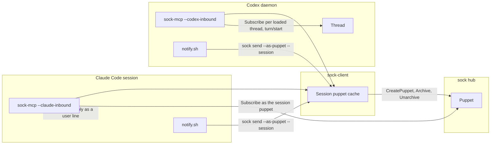
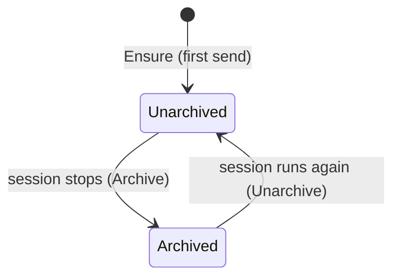
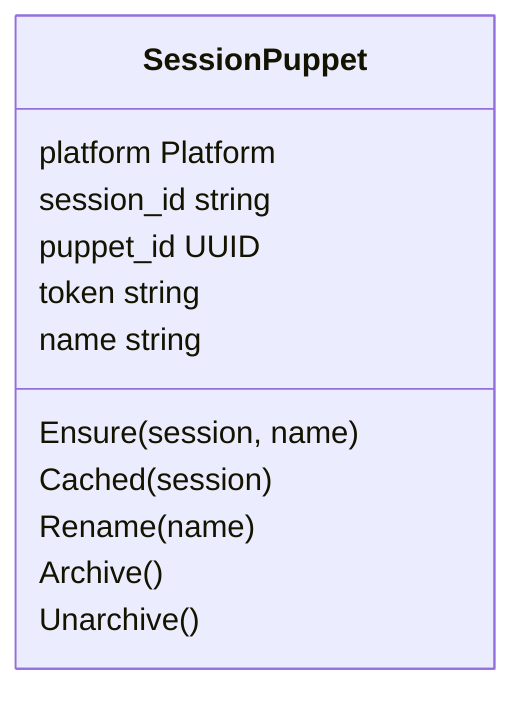
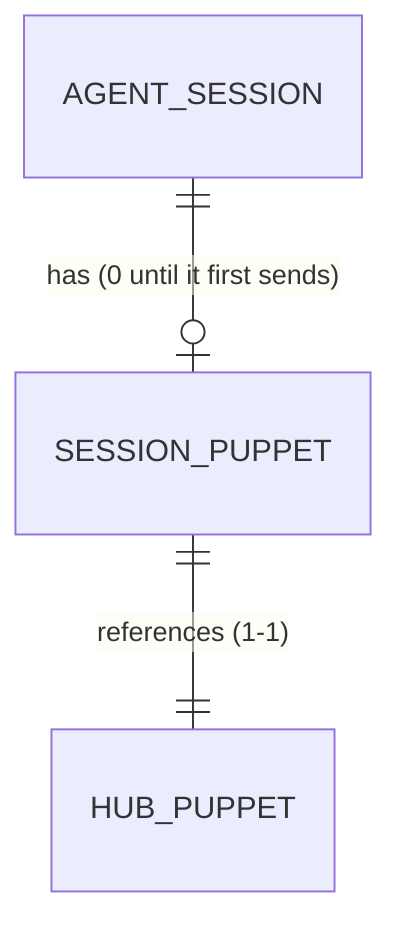

# Session puppets

Pass 2 (2026-10-16): Claude Code replies enter through the session inbox. Beads integrations-ad2, integrations-ard. Decisions: [ADR 3](../adr/0003-a-puppet-per-agent-session.md), [ADR 4](../adr/0004-claude-replies-enter-through-the-session-inbox.md), [sock-contract ADR 27](https://github.com/aeryx-ai/sock-contract/blob/main/docs/adr/0027-a-puppet-per-agent-session-archived-when-it-ends.md). Hub contract: sock-contract `api.md` (`CreatePuppet`, `MintPuppetToken`, `UpdateDisplayName`, `ArchivePuppet`, `UnarchivePuppet`, `Subscribe`).

## Context map

Supporting subdomain. Integrations is conformist downstream of the hub's Identity and Messaging contracts and an anti-corruption layer over each platform's session vocabulary (Claude Code's session and its title, Codex's thread and its name). No platform term reaches the hub: it sees a puppet with a display name.

### Language

| Term | Meaning |
|---|---|
| Agent session | One Claude Code session or one Codex thread. Identity: platform plus session id. |
| Platform | `claude-code` or `codex` (enumeration). |
| Session id | Claude Code's `CLAUDE_CODE_SESSION_ID` (a UUID); Codex's thread id. `[A-Za-z0-9_-]{1,64}`. |
| Session name | Claude Code: the last `custom-title` in the session's transcript (`/rename`). Codex: the thread's `name` (its auto title after the first turn, or the owner's rename). Absent: the project directory's name and the first 8 characters of the session id. |
| Session puppet | The puppet of one agent session, display name `<session name> on <host>`. |
| Running | Claude Code: the session's `sock-mcp` is alive (it holds the session's run lock). Codex: the daemon has the thread loaded. |
| Archived | The hub's fact (ADR 27): the session puppet's session is not running. |

Stored: the session puppet cache (token per session). Derived: running (a lock or the daemon's loaded list), the display name (from the session name, pushed to the hub when it differs).

## Domain model

### Session puppet (entity, identity: platform and session id)

| Field | Type | Meaning |
|---|---|---|
| platform | Platform | Which platform's session. |
| session_id | string | The session id. |
| puppet_id | UUID | The hub puppet. |
| token | `sock_pt_` | Its token, cached at mode 0600; never logged. |
| name | string, 1 to 64 | The display name last set on the hub. |

Behaviors, all in sock-client:
- `Ensure(session, name)`: the cached token, else `CreatePuppet` with the machine key, named `<name> on <host>` cut to 64 bytes on a UTF-8 boundary; on `PUPPET_NAME_TAKEN` the name gets ` <first 6 of sha256(platform:session id)>` and is retried once. Cached before it returns.
- `Cached(session)`: the cached token or none; never mints.
- `Rename(name)`: `UpdateDisplayName` with the puppet's token when `<name> on <host>` differs from the cached name.
- `Archive()`, `Unarchive()`: with the machine key; both idempotent at the hub.

Invariants: one puppet per (hub, platform, session id), enforced by the cache file's name and a per-session lock around `Ensure`; session id matches its pattern (it names a file); the token in the cache is a puppet token.

Anything unlisted does not happen. Nothing erases a session puppet.

## Per platform

### Claude Code

- `sock-mcp --outbound-only --claude-inbound` reads `CLAUDE_CODE_SESSION_ID` at start and takes the session's run lock (`flock` on `run/<platform>-<session id>.lock` in the cache directory, held for the process's life) before it listens.
- Any tool call ensures the session puppet, then runs as it. The listener subscribes as the session puppet once it is cached: at start when it already is, right after the first call, or within 2 seconds of a hook's send caching it.
- Each owner reply is written into the session's inbox (`CLAUDE_CODE_MESSAGING_SOCKET`, an auth line with `CLAUDE_CODE_MESSAGING_TOKEN`, then a `user` line holding the `<sock-message from="owner">` prompt) and acknowledged once the inbox took it. An inbox that refuses is retried 5 times with backoff, then the reply waits at the hub. No inbox in the environment: no listener, tools only.
- Without a machine key or session id the server runs as the project's puppet and listens as it from the start.
- At start with a cached puppet: `Unarchive`. At exit (stdin closed, SIGTERM): `Archive`.
- The name: the last `custom-title` line of `${CLAUDE_CONFIG_DIR:-~/.claude}/projects/*/<session id>.jsonl`, read at start and at each call (only what was appended since); `Rename` once the session has a title. A session never titled keeps the name it was made with.
- `notify.sh`: `sock send --as-puppet --session claude-code:<session_id> [--session-name <title>]`, the title read from the hook's `transcript_path` the same way and passed only when there is one.

### Codex

- Tool calls: the session is `_meta["x-codex-turn-metadata"].thread_id`; the per-call client becomes the thread's session puppet (replacing the `sandboxCwd` project puppet). The name: `thread/read` `name` from the daemon.
- `notify.sh`: `sock send --as-puppet --session codex:<session_id>` without a name; the listener renames it.
- The listener (ADR 2's lock holder): on each rescan, for every cached Codex session puppet, a loaded thread means `Unarchive`, subscribe as it and inject into exactly that thread; not loaded means `Archive`. `thread/name/updated` renames. No session asks, no project matching, no choice of session.

## Archiving

| Platform | Archive when | Unarchive when | Reconciled by |
|---|---|---|---|
| Claude Code | its `sock-mcp` exits (stdin closed, SIGINT, SIGTERM) | its `sock-mcp` listens with the puppet cached | any `sock-mcp` start: cached Claude Code session puppets whose run lock is free are archived (a server that crashed) |
| Codex | the daemon no longer has the thread loaded | the thread is loaded again | the listener's rescans |

A failed archive call is retried at the next reconciliation; it never blocks a send or a start.

## Contracts

### API (consumed)

| RPC | Caller | Used for | Errors handled |
|---|---|---|---|
| `CreatePuppet` | machine key | `Ensure` | `PUPPET_NAME_TAKEN` (hash suffix, once), `LIMIT_REACHED` (not expected: ADR 27 has no cap; logged), transient (retried with backoff) |
| `UpdateDisplayName` | session puppet | `Rename` | `FIELD_INVALID` (logged, name kept) |
| `ArchivePuppet`, `UnarchivePuppet` | machine key | archiving | `NOT_FOUND` (a puppet this key did not create: dropped from the cache), transient (next reconciliation) |
| `Subscribe` | session puppet | replies | as the `channel` package |

### Local interfaces

| Interface | Caller | Change |
|---|---|---|
| sock-client `SessionPuppets` (`Ensure`, `Cached`, `Rename`, `Archive`, `Unarchive`, `Reconcile`) | sock-mcp, sock-cli | new; replaces `ProjectPuppet` for agents |
| `sock send --as-puppet --session <platform>:<id> [--session-name <name>]` | notify.sh | new flags (sock-cli) |
| `sock-mcp --claude-inbound` | Claude Code | session from the environment, as above |
| Session inbox (Claude Code, undocumented) | sock-mcp | auth line, then a `user` line; nothing answered on success |

### Events

None of ours. The hub emits `PuppetArchiveChanged` to the owner's apps.

### Data (local, the owner's machine)

| Store | Shape | Key | Constraints |
|---|---|---|---|
| `puppets/<hub key>/sessions/<sha256(platform:session id)>` | the token | platform and session id | mode 0600, written by temp file and rename under the session lock |
| `…/sessions/<hash>.meta` | platform, session id, puppet id, name: one per line | as above | as above |
| `…/run/<platform>-<session id>.lock` | empty, `flock` | session | held by the running Claude Code server |

Recorded exception to the local-state rule (SQLite): the cache is ADR 10's file layout with a new key, shared with the CLI, and each entry is one token replaced whole.

### Cross-check

| Transition | Interface | Hub call | Store |
|---|---|---|---|
| First send | sock_send, notify.sh | `CreatePuppet` | sessions/<hash> |
| Rename | start, send, `thread/name/updated` | `UpdateDisplayName` | .meta name |
| Stop | server exit, thread unloaded, reconciliation | `ArchivePuppet` | none |
| Resume | server start, thread loaded | `UnarchivePuppet` | none |

## Removed

`internal/asks`, notify.sh `record_ask`, the injector's project matching and session choice, and the per-project subscriptions. Project puppets are left on the hub, unused.

## Decisions

1. A session with no name yet (a Claude Code session never renamed, a Codex thread before its first turn) is named for its project directory and the first 8 characters of its session id, and renamed once it has a name (owner, 2026-10-15).

## Open questions

1. A Claude Code session resumed with `--resume` in a different directory: same session id, so the same puppet. Assumed fine.
